# Findings: base batch

Generated by `experiments/analyze.py`; every number below is recomputed from the raw results.

## Verdicts at a glance

| Test | Verdict |
|---|---|
| H1 | PASS (per-rule medians: ratio ≤ 1.2, z² in [0.8, 1.25]; \|z\| > 3 share < 1%. Relaxed from the per-run criterion, which 174 of 414 runs miss; see the text) |
| H2 | PASS (tabular on the line (R² ≥ 0.95, slope 0.9–1.1) and RMSE increasing with the interference share) |
| H3 1 | PASS (every tabular run has 0 decreases and 0 absorbed (the proposition)) |
| H3 3 | FAIL (pre-registered: an interference-weighted candidate beats s̄ alone on held-out levels and no level is shifted by more than one decade; best held-out candidate is (i) s̄, max shift 4.69 decades) |
| H4 (a) | PASS (median \|error\| = 0.0001 ≤ 0.01 and the guide value 0.109 reproduced) |
| H4 (b) | FAIL (pre-registered: slope against η/β in 0.8–1.2 for both directions, η/β ≤ 2) |
| H5 | PASS (pre-registered: GRPO's best G falls as p₀ rises in tabular (Spearman -0.95) and the mean rule's samples-to-target vary by at most 2× over G (max 2.00)) |

## H1: the identity E[ĝ] = W_G(p)∇p (gradcheck, 414 runs)

Each run averages R = 4000 sampled updates at fixed parameters and compares them with −(1/B)Σ W_G(p_x)∇p_x from autograd. Without bias, ‖error‖ ≈ ‖Monte Carlo SE‖, so `rel_err / mc_rel` ≈ 1 and the mean squared z-score ≈ 1.

| rule | runs | median_ratio | max_ratio | median_z2 | frac_z_gt3 | min_cosine |
|---|---|---|---|---|---|---|
| grpo | 72 | 0.971 | 1.31 | 0.927 | 0.00189 | 0.989 |
| maxrl | 72 | 0.99 | 1.62 | 0.955 | 0.00274 | 0.989 |
| mean | 72 | 0.978 | 1.32 | 0.93 | 0.0018 | 0.989 |
| passk2 | 72 | 0.971 | 1.42 | 0.953 | 0.00323 | 0.994 |
| passk4 | 54 | 0.978 | 1.5 | 0.983 | 0.00413 | 0.998 |
| rloo | 72 | 0.978 | 1.32 | 0.93 | 0.0018 | 0.989 |

| level | init | median_ratio | median_z2 | frac_z_gt3 |
|---|---|---|---|---|
| lin | sft_up | 0.965 | 0.882 | 0.00242 |
| lin | uniform | 1.03 | 1.01 | 0.0034 |
| m64 | sft_up | 1.03 | 0.928 | 0.00164 |
| m64 | uniform | 0.985 | 0.908 | 0.00113 |
| tab | tabular | 0.994 | 1.07 | 0.00525 |
| tab | uniform | 0.942 | 0.883 | 0.00136 |

Runs outside ratio ≤ 1.2 or mean z² in [0.8, 1.25]: **174 of 414**. Overall share of |z| > 3: 0.0025 (Gaussian: 0.0027).

The plan's criterion was per configuration, but H1 has one run per configuration, so it judges single noisy statistics: the ratio's 5–95% range is 0.76–1.26 around a median of 0.98, symmetric about 1, and mean z² averages correlated coordinates. A bias would shift a whole rule or level; no rule or level median moves. The verdict below therefore uses the group medians; the literal per-run criterion fails.

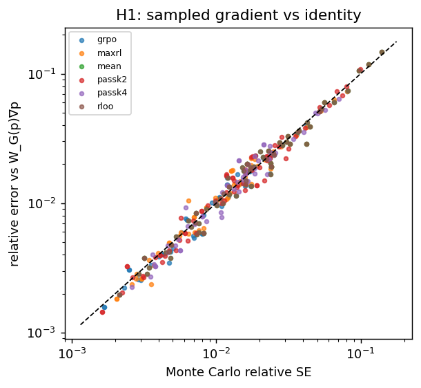

**Verdict: PASS** (per-rule medians: ratio ≤ 1.2, z² in [0.8, 1.25]; |z| > 3 share < 1%. Relaxed from the per-run criterion, which 174 of 414 runs miss; see the text)

## H2: does parameter sharing distort the finite-G surrogate? (207 one-step + 207 short-training runs)

**First-order check.** Per run, the measured mean one-step change Δp_x (R repeats from the same θ, η = 0.5, full batch) is regressed on the predicted drift d_x = η∇p_x·mean_j W_G(p_j)∇p_j. *cross_share* = Σ|d_x − own_x| / Σ|d_x|, the part of the drift that comes from other prompts.

| level | runs | median_slope | median_R2 | min_R2 | cross_share |
|---|---|---|---|---|---|
| tab | 69 | 1.000 | 1.000 | 0.998 | 0.000 |
| lin | 69 | 0.983 | 0.999 | 0.993 | 0.932 |
| m64 | 69 | 1.030 | 0.999 | 0.998 | 0.966 |

**The milestone plot.** Each rule run is paired with the mean-rule run at the same level, G and seed (same warm start, so the same θ). Prompts are binned by p into deciles; y is the ratio of binned measured changes Δp(rule)/Δp(mean), x the no-sharing prediction Σ own(rule)/Σ own(mean), i.e. the W_G-weighted ratio. Bins whose mean-rule change is within 3 SE of 0 are dropped.

| level | bins | slope | R2_vs_identity | RMSE | median_abs_dev | cross_share |
|---|---|---|---|---|---|---|
| tab | 570 | 1.000 | 1.000 | 0.007 | 0.000 | 0.000 |
| lin | 570 | 0.965 | 0.962 | 0.133 | 0.031 | 0.932 |
| m64 | 570 | 1.040 | 0.032 | 4.343 | 0.110 | 0.966 |

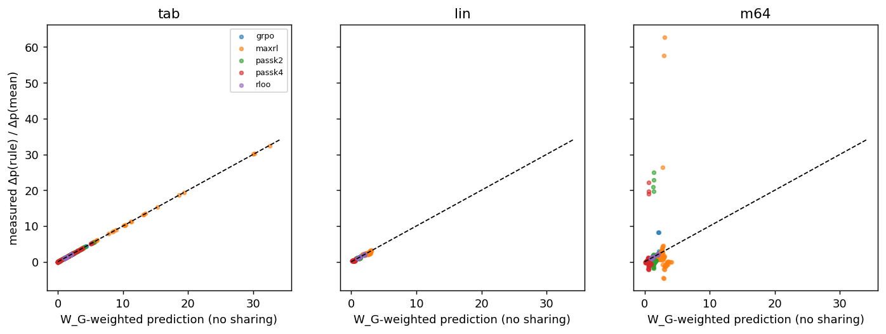

Every level's measured change is explained by the full first-order drift (R² ≈ 0.999 above), but only the tabular level follows the per-prompt W_G-weighted prediction. With sharing, most of each prompt's drift comes from other prompts (cross_share > 0.9), so a rule's W_G(p) no longer sets how fast that prompt moves relative to another rule; the effect is large for the MLP and small for the linear model.

**Verdict: PASS** (tabular on the line (R² ≥ 0.95, slope 0.9–1.1) and RMSE increasing with the interference share)

**Does the trajectory depend on G? (Ghosh et al.)** Mean success after 200 steps of ordinary training (B = 32), averaged over seeds:

| level | rule | G=2 | G=4 | G=16 | G=64 | max/min over G |
|---|---|---|---|---|---|---|
| tab | grpo | 0.467 | 0.493 | 0.515 | 0.520 | 1.115 |
| tab | maxrl | 0.467 | 0.503 | 0.546 | 0.560 | 1.200 |
| tab | mean | 0.445 | 0.456 | 0.464 | 0.466 | 1.045 |
| tab | passk2 | 0.446 | 0.461 | 0.473 | 0.476 | 1.066 |
| tab | passk4 | nan | 0.440 | 0.446 | 0.447 | 1.016 |
| tab | rloo | 0.467 | 0.466 | 0.466 | 0.466 | 1.001 |
| lin | grpo | 0.834 | 0.865 | 0.885 | 0.892 | 1.070 |
| lin | maxrl | 0.834 | 0.853 | 0.856 | 0.856 | 1.026 |
| lin | mean | 0.785 | 0.816 | 0.832 | 0.836 | 1.064 |
| lin | passk2 | 0.742 | 0.777 | 0.794 | 0.799 | 1.077 |
| lin | passk4 | nan | 0.642 | 0.653 | 0.654 | 1.018 |
| lin | rloo | 0.834 | 0.835 | 0.836 | 0.837 | 1.003 |
| m64 | grpo | 0.578 | 0.677 | 0.739 | 0.754 | 1.305 |
| m64 | maxrl | 0.578 | 0.684 | 0.727 | 0.727 | 1.258 |
| m64 | mean | 0.484 | 0.531 | 0.565 | 0.574 | 1.186 |
| m64 | passk2 | 0.474 | 0.523 | 0.552 | 0.557 | 1.175 |
| m64 | passk4 | nan | 0.432 | 0.438 | 0.437 | 1.012 |
| m64 | rloo | 0.578 | 0.578 | 0.576 | 0.577 | 1.003 |

## H3 (main): effective step, sharing and absorption (13,608 runs)

Grid: 6 sharing levels × L {1, 2, 4} × 7 (B, G) pairs × rules {mean, rloo, grpo} × 12 η × 3 seeds, 5000 steps of plain SGD, β = 0. *Absorbed* = share of prompts that started at p ≥ 0.01 and end below 0.01. (The plan said 3000 steps and 10 η values; the batch ran 5000 and 12.)

### 1. Tabular runs never lose a prompt

Tabular runs: 2268. Runs with any per-prompt decrease of p: **0**. Runs with any absorbed prompt: **0**. Largest absorbed fraction: 0. Total decreases logged: 0.

**Verdict: PASS** (every tabular run has 0 decreases and 0 absorbed (the proposition))

### 2. Absorbed fraction against η

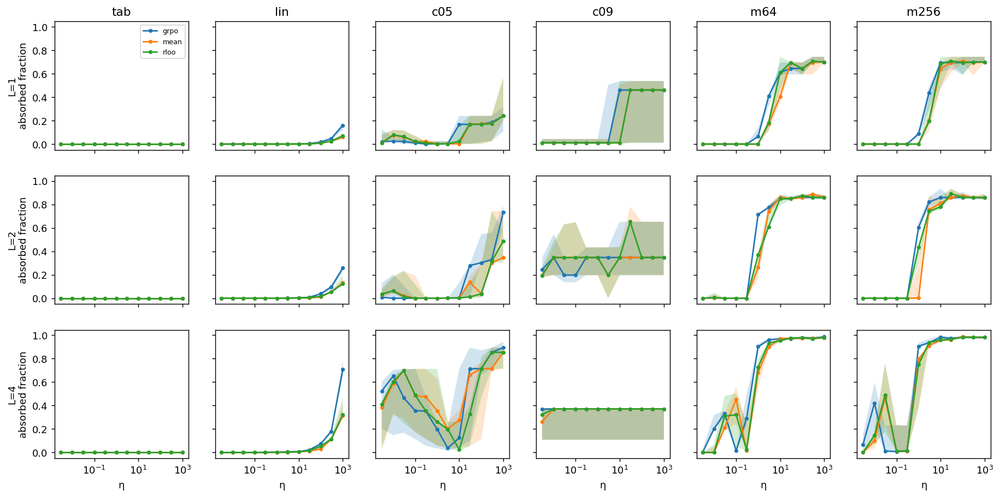

η* (smallest η with seed-median absorbed ≥ 0.1; blank: never on the grid 0.003–1000), B = 32, G = 8:

| level | L | grpo | mean | rloo |
|---|---|---|---|---|
| tab | 1 | nan | nan | nan |
| tab | 2 | nan | nan | nan |
| tab | 4 | nan | nan | nan |
| lin | 1 | 1e+03 | nan | nan |
| lin | 2 | 1e+03 | 1e+03 | 1e+03 |
| lin | 4 | 300 | 300 | 300 |
| c05 | 1 | 10 | 30 | 30 |
| c05 | 2 | 30 | 30 | 300 |
| c05 | 4 | 0.003 | 0.003 | 0.003 |
| c09 | 1 | 10 | 30 | 30 |
| c09 | 2 | 0.003 | 0.003 | 0.003 |
| c09 | 4 | 0.003 | 0.003 | 0.003 |
| m64 | 1 | 3 | 3 | 3 |
| m64 | 2 | 1 | 1 | 1 |
| m64 | 4 | 0.01 | 0.03 | 0.03 |
| m256 | 1 | 3 | 3 | 3 |
| m256 | 2 | 1 | 3 | 1 |
| m256 | 4 | 0.01 | 0.01 | 0.01 |

Caveat for L = 4: prompts start at p = 3⁻⁴ ≈ 0.0123, so a dip of 0.002 counts as absorbed; the very small L = 4 thresholds mostly reflect that, not a large loss.

Configurations already absorbing at the smallest η (0.003): **64**, levels {'c09': 42, 'c05': 20, 'm256': 2}. At those, absorption is not a step-size effect.

### 3. Does one variable collapse the shared levels?

| candidate | pooled_AUC | pooled_deviance | held_out_deviance | held_out_AUC_mean | max_level_shift_decades |
|---|---|---|---|---|---|
| (i) s̄ | 0.718 | 1.097 | 1.188 | 0.780 | 4.692 |
| (ii) s̄·‖∇z‖² | 0.717 | 1.115 | 1.217 | 0.798 | 4.543 |
| (iii) (ii)·|cos| | 0.741 | 1.109 | 1.204 | 0.787 | 5.786 |
| (iv) (ii)·(1+B·cos) | 0.734 | 1.136 | 1.243 | 0.804 | 5.659 |

Per-level midpoint shifts (decades of x, relative to the pooled fit):

| candidate | shift_lin | shift_c05 | shift_c09 | shift_m64 | shift_m256 |
|---|---|---|---|---|---|
| (i) s̄ | +1.52 | +3.51 | +4.69 | -2.02 | -2.01 |
| (ii) s̄·‖∇z‖² | +1.37 | +2.39 | +4.54 | -2.75 | -2.27 |
| (iii) (ii)·|cos| | +1.16 | +2.58 | +5.79 | -2.64 | -2.24 |
| (iv) (ii)·(1+B·cos) | +0.84 | +1.62 | +5.66 | -3.39 | -2.89 |

Robustness, L ≤ 2 only (at L = 4 every prompt starts at p = 0.0123, just above the 0.01 line, so "absorbed" can mean a dip of 0.002):

| candidate | pooled_AUC | held_out_deviance | max_level_shift_decades | shift_lin | shift_c05 | shift_c09 | shift_m64 | shift_m256 |
|---|---|---|---|---|---|---|---|---|
| (i) s̄ | 0.81 | 1.01 | 2.38 | 1.26 | 1.23 | 2.38 | -1.58 | -1.60 |
| (ii) s̄·‖∇z‖² | 0.80 | 1.13 | 2.38 | 1.20 | 1.13 | 2.35 | -2.38 | -1.92 |
| (iii) (ii)·|cos| | 0.82 | 1.03 | 3.31 | 0.95 | 1.26 | 3.31 | -2.16 | -1.79 |
| (iv) (ii)·(1+B·cos) | 0.80 | 1.09 | 3.32 | -2.46 | 0.85 | 3.32 | -2.99 | -2.51 |

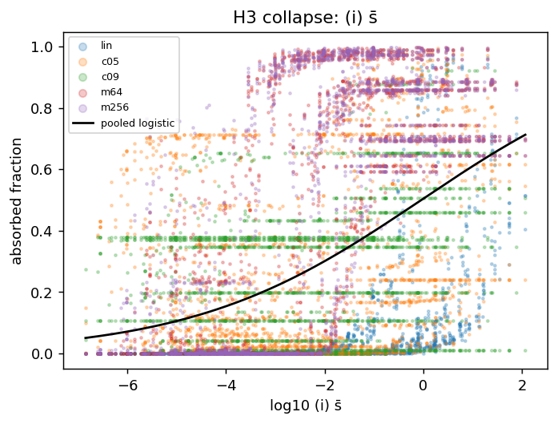

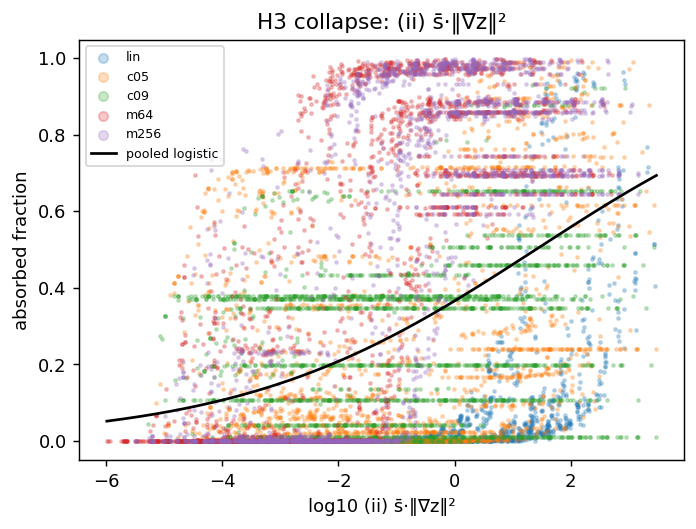

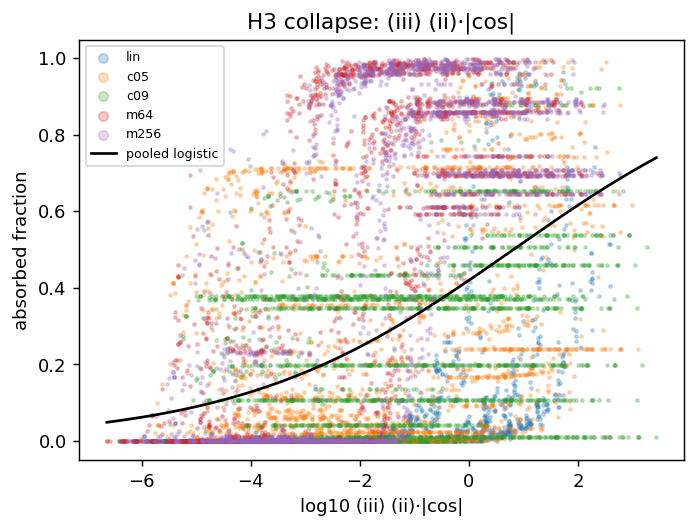

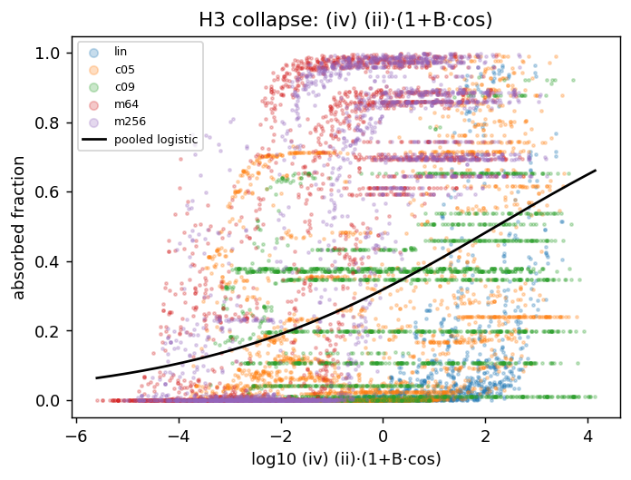

**Verdict: FAIL** (pre-registered: an interference-weighted candidate beats s̄ alone on held-out levels and no level is shifted by more than one decade; best held-out candidate is (i) s̄, max shift 4.69 decades)

### 4. Does η* scale with B (s̄ ∝ η/B)?

Slope of log η* against log B, over 34 (level, L, rule) groups with an interior threshold at two or more B: median **0.83** (IQR 0.00–1.17). s̄ ∝ η/B predicts 1; a slope of 0 would mean B does not matter.

### 4b. Post hoc: two ways to be absorbed

*Not pre-registered; added after the collapse failed.* Every prompt starts at the same p (uniform initialization gives p = K^−L for all prompts), so any difference in fate comes from the parameter sharing. The first-order predicted drift d_x at initialization (`predicted_drift`) separates two mechanisms:

| level | share_negative_drift | P(abs|d<0) η≤1 | P(abs|d≥0) η≤1 | P(abs|d<0) η>1 | P(abs|d≥0) η>1 | η*-vs-B slope |
|---|---|---|---|---|---|---|
| lin | 0.004 | 0.020 | 0.002 | 0.647 | 0.441 | 1.661 |
| c05 | 0.105 | 0.538 | 0.209 | 0.893 | 0.525 | 0.000 |
| c09 | 0.016 | 0.988 | 0.205 | 1.000 | 0.355 | 0.396 |
| m64 | 0.377 | 0.306 | 0.248 | 0.841 | 0.871 | 0.830 |
| m256 | 0.345 | 0.282 | 0.258 | 0.817 | 0.877 | 0.830 |

- **Interference drift (correlated features, c05 and c09).** Initial drift ranks the prompts that end up absorbed (AUC in section 7), a negative drift makes absorption likely even at small η, the absorbed share plateaus over decades of η, and η* hardly moves with B. Absorption here is deterministic and set by the geometry, so step size only sets how fast it happens.
- **Step noise (MLPs).** Initial drift barely matters, absorption needs a large enough step, and η* grows with B close to the s̄ ∝ η/B prediction. Within this regime s̄ alone already lines up the two MLP widths (section 3 shifts).
- One initial-diagnostic variable cannot collapse both mechanisms, which is why section 3 fails. This is exactly what H3 stretch goals 2 (per-prompt predictor) and 3 (drift against noise) test.

### 5. Group size at a fixed budget BG = 256

η* by G (all L pooled by taking the median threshold over L):

| level | rule | G=2 | G=4 | G=8 | G=16 | G=64 |
|---|---|---|---|---|---|---|
| lin | grpo | 1e+03 | 650 | 1e+03 | 300 | 30 |
| lin | mean | nan | 1e+03 | 650 | 300 | 100 |
| lin | rloo | 1e+03 | 1e+03 | 650 | 300 | 100 |
| c05 | grpo | 100 | 30 | 10 | 10 | 10 |
| c05 | mean | 100 | 30 | 30 | 30 | 30 |
| c05 | rloo | 100 | 30 | 30 | 30 | 30 |
| c09 | grpo | 0.003 | 0.003 | 0.003 | 0.003 | 0.003 |
| c09 | mean | 0.003 | 0.003 | 0.003 | 0.003 | 0.003 |
| c09 | rloo | 0.003 | 0.003 | 0.003 | 0.003 | 0.003 |
| m64 | grpo | 3 | 1 | 1 | 0.3 | 0.1 |
| m64 | mean | 3 | 3 | 1 | 1 | 0.3 |
| m64 | rloo | 3 | 3 | 1 | 1 | 0.3 |
| m256 | grpo | 3 | 1 | 1 | 0.3 | 0.1 |
| m256 | mean | 3 | 3 | 3 | 1 | 0.3 |
| m256 | rloo | 3 | 3 | 1 | 1 | 0.3 |

Best final mean success over η (median over seeds, max over η, mean over L):

| level | rule | G=2 | G=4 | G=8 | G=16 | G=64 |
|---|---|---|---|---|---|---|
| tab | grpo | 1.000 | 1.000 | 1.000 | 1.000 | 1.000 |
| tab | mean | 1.000 | 1.000 | 1.000 | 1.000 | 1.000 |
| tab | rloo | 1.000 | 1.000 | 1.000 | 1.000 | 1.000 |
| lin | grpo | 0.986 | 0.985 | 0.982 | 0.972 | 0.948 |
| lin | mean | 0.987 | 0.984 | 0.983 | 0.971 | 0.945 |
| lin | rloo | 0.986 | 0.985 | 0.983 | 0.971 | 0.945 |
| c05 | grpo | 0.920 | 0.955 | 0.953 | 0.964 | 0.924 |
| c05 | mean | 0.916 | 0.957 | 0.902 | 0.910 | 0.848 |
| c05 | rloo | 0.921 | 0.906 | 0.954 | 0.908 | 0.845 |
| c09 | grpo | 0.757 | 0.806 | 0.756 | 0.795 | 0.797 |
| c09 | mean | 0.755 | 0.757 | 0.803 | 0.752 | 0.749 |
| c09 | rloo | 0.757 | 0.754 | 0.806 | 0.753 | 0.780 |
| m64 | grpo | 0.996 | 0.995 | 0.994 | 0.996 | 0.975 |
| m64 | mean | 0.994 | 0.995 | 0.994 | 0.990 | 0.794 |
| m64 | rloo | 0.995 | 0.995 | 0.992 | 0.990 | 0.796 |
| m256 | grpo | 0.998 | 0.997 | 0.997 | 0.999 | 0.998 |
| m256 | mean | 0.995 | 0.996 | 0.996 | 0.996 | 0.978 |
| m256 | rloo | 0.996 | 0.997 | 0.995 | 0.996 | 0.983 |

### 6. When prompts get absorbed

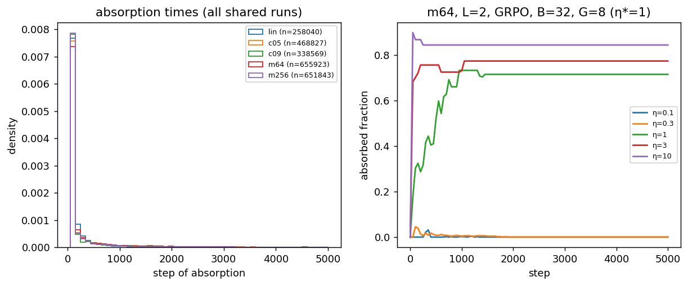

Share of absorptions in the first 500 of 5000 steps: 0.88.

### 7. Previews of the H3 stretch goals from the existing data

**Per-prompt absorption predictor** (median AUC over runs with 5–95% absorbed). Scores: most negative predicted first-step drift d_x; the same in logit units d_x/(p(1−p)); lowest initial p_x; lowest p_x(1−p_x). Every prompt starts at the same p in these runs, so the two p baselines are 0.5 by construction; the H5 warm-started runs or the stretch grid are needed for a real baseline comparison.

| level | runs | auc_drift | auc_logit_drift | auc_p_init | auc_p_var |
|---|---|---|---|---|---|
| lin | 335 | 0.772 | 0.772 | 0.500 | 0.500 |
| c05 | 1266 | 0.880 | 0.880 | 0.500 | 0.500 |
| c09 | 1690 | 1.000 | 1.000 | 0.500 | 0.500 |
| m64 | 949 | 0.642 | 0.642 | 0.500 | 0.500 |
| m256 | 911 | 0.617 | 0.617 | 0.500 | 0.500 |

**Lost problems:** 2373202 prompts were absorbed across the shared runs. Their starting p is K^−L (0.33, 0.11 or 0.012 for L = 1, 2, 4), so the share that started above 0.05 (**0.55**) only says how many came from L ≤ 2: absorption is not limited to prompts that were hard at the start.

Exact pass@64 before and after training, in runs with > 10% absorbed (mean over runs):

| level | before | after |
|---|---|---|
| lin | 0.776 | 0.615 |
| c05 | 0.748 | 0.548 |
| c09 | 0.801 | 0.656 |
| m64 | 0.811 | 0.257 |
| m256 | 0.813 | 0.245 |

**ρ = 0.9 at small η** (smoke test: about 35% absorbed at every η). Absorbed fraction by η, all c09 runs:

| eta | median | mean | max |
|---|---|---|---|
| 0.003 | 0.176 | 0.165 | 0.379 |
| 0.010 | 0.197 | 0.210 | 0.613 |
| 0.030 | 0.197 | 0.223 | 0.652 |
| 0.100 | 0.197 | 0.216 | 0.652 |
| 0.300 | 0.197 | 0.205 | 0.639 |
| 1.000 | 0.197 | 0.206 | 0.652 |
| 3.000 | 0.197 | 0.227 | 0.652 |
| 10.000 | 0.348 | 0.301 | 0.873 |
| 30.000 | 0.371 | 0.351 | 0.930 |
| 100.000 | 0.371 | 0.363 | 0.922 |
| 300.000 | 0.371 | 0.373 | 0.922 |
| 1000.000 | 0.371 | 0.372 | 0.922 |

## H4: KL fixed points, fluctuations and the stability threshold (1,968 runs)

### (a) Where training settles (960 runs; 64 identical tabular prompts, η = 1, B = 64, 6000 steps)

Measured p* is the mean success over the second half of training; the prediction is the stable root of the finite-G fixed-point equation (`theory.fixed_points`) reached from p_ref.

Runs still moving at step 6000 (final mean differs from the second-half mean by > 5%): **104 of 960**, all at p_ref 0.01, β 0.5, forward (21), p_ref 0.01, β 0.5, reverse (21), p_ref 0.01, β 1.0, forward (21), p_ref 0.01, β 1.0, reverse (21), p_ref 0.01, β 2.0, forward (17), p_ref 0.05, β 0.5, forward (3). From p_ref = 0.01 the drive W_G(p)p(1−p) is tiny, so 6000 steps at η = 1 are not enough; the errors below are reported for all runs and for converged runs.

| kl | rule | runs | median_abs_error | max_abs_error | mean_error | converged | median_abs_error_conv | max_abs_error_conv |
|---|---|---|---|---|---|---|---|---|
| forward | grpo | 240 | 9.37e-05 | 0.445 | -0.00935 | 219 | 8.07e-05 | 0.00283 |
| forward | mean | 240 | 8.57e-05 | 0.445 | -0.0239 | 199 | 6.55e-05 | 0.00496 |
| reverse | grpo | 240 | 0.000137 | 0.0497 | -0.00265 | 228 | 0.000133 | 0.0497 |
| reverse | mean | 240 | 6.95e-05 | 0.0336 | -0.00185 | 210 | 5.47e-05 | 0.00208 |

Guide check (p_ref 0.05, β 2, G 4, KL(π‖π_ref)); the guide value is 0.109:

| rule | predicted | measured |
|---|---|---|
| grpo | 0.1090 | 0.1090 |
| mean | 0.0711 | 0.0711 |

Largest errors among converged runs (seed-averaged):

| p0 | beta | G | rule | kl | predicted | measured | abs_error | stable_roots |
|---|---|---|---|---|---|---|---|---|
| 0.0500 | 0.5000 | 16 | grpo | reverse | 0.9889 | 0.9394 | 0.0495 | 1 |
| 0.0500 | 0.5000 | 64 | grpo | reverse | 1.0000 | 0.9897 | 0.0103 | 1 |
| 0.2000 | 0.5000 | 8 | grpo | reverse | 0.9767 | 0.9665 | 0.0102 | 1 |
| 0.2000 | 0.5000 | 16 | grpo | reverse | 0.9982 | 0.9883 | 0.0098 | 1 |
| 0.5000 | 0.5000 | 8 | grpo | reverse | 0.9948 | 0.9860 | 0.0088 | 1 |
| 0.5000 | 0.5000 | 16 | grpo | reverse | 0.9996 | 0.9932 | 0.0064 | 1 |
| 0.5000 | 0.5000 | 4 | grpo | reverse | 0.9688 | 0.9634 | 0.0054 | 1 |
| 0.5000 | 1.0000 | 64 | grpo | reverse | 0.9996 | 0.9942 | 0.0054 | 1 |

Configurations with more than one stable root: **2** (p_ref 0.2, β 1.0, G 64, grpo, reverse, p_ref 0.01, β 0.5, G 64, grpo, reverse).

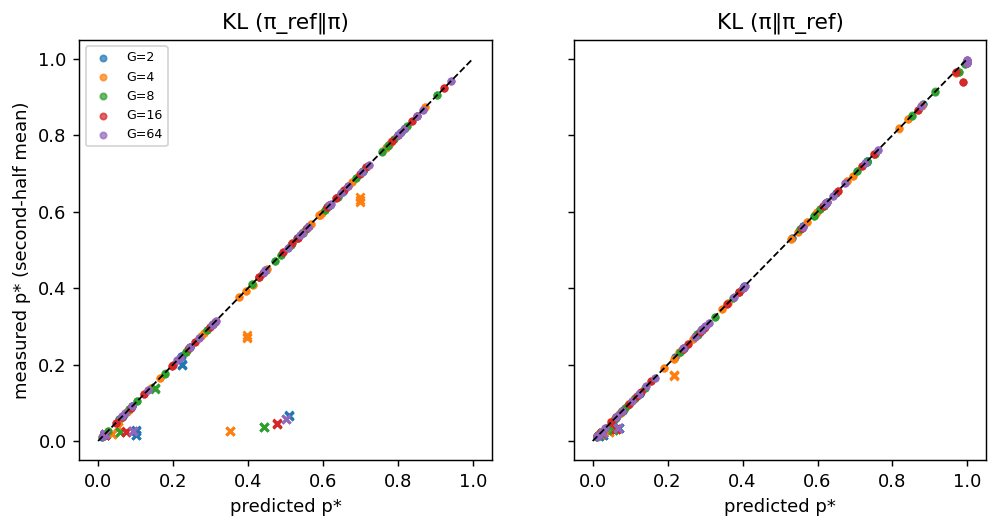

**Verdict: PASS** (median |error| = 0.0001 ≤ 0.01 and the guide value 0.109 reproduced)

### (b) Fluctuations around the fixed point (144 runs; G = 8, GRPO, p_ref 0.05)

Var(logit p) across the 64 replicate prompts, averaged over second-half snapshots. A linear (Ornstein-Uhlenbeck) approximation predicts Var ∝ η/β, a log-log slope of 1.

Runs whose second-half mean is still > 0.02 from p* (not yet at equilibrium, so their spread is a transient): **24 of 144**, at η = [0.1, 0.3, 30.0]. They are excluded from the fits.

| kl | slope_eta_over_beta_le_2 | slope_all | slope_in_eta_fixed_beta_median | slope_in_eta_min | slope_in_eta_max |
|---|---|---|---|---|---|
| forward | 0.396 | 0.69 | 1 | 0.93 | 1.05 |
| reverse | 0.79 | 0.914 | 1.05 | 1.03 | 1.17 |

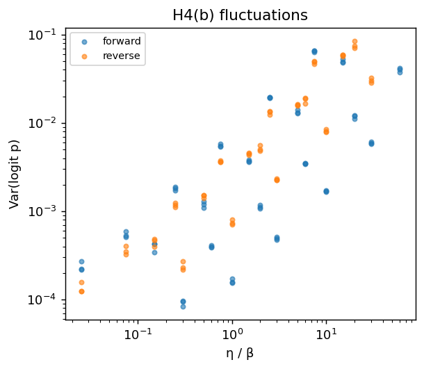

**Verdict: FAIL** (pre-registered: slope against η/β in 0.8–1.2 for both directions, η/β ≤ 2)

Post-hoc reading: η/β is not a sufficient variable, because p* (and with it the per-step noise and the restoring rate) moves with β. At fixed β the slope in η is the clean test of the linear-noise picture; its median is shown in the table above.

### (c) KL and the absorption threshold (1,152 runs plus β = 0 from H3)

η* is the smallest η whose seed-median absorbed fraction is ≥ 0.1 (blank: never reached on the grid).

| level | rule | kl | β=0.0 | β=0.1 | β=0.5 | β=2.0 |
|---|---|---|---|---|---|---|
| c05 | grpo | forward | 30 | 10 | 3 | 1 |
| c05 | grpo | reverse | 30 | 100 | 100 | 3 |
| c05 | mean | forward | 30 | 10 | 3 | 1 |
| c05 | mean | reverse | 30 | 300 | 30 | 1 |
| m64 | grpo | forward | 1 | 100 | 30 | 10 |
| m64 | grpo | reverse | 1 | 1 | 1 | 10 |
| m64 | mean | forward | 1 | 100 | 30 | 10 |
| m64 | mean | reverse | 1 | 1 | 30 | 10 |

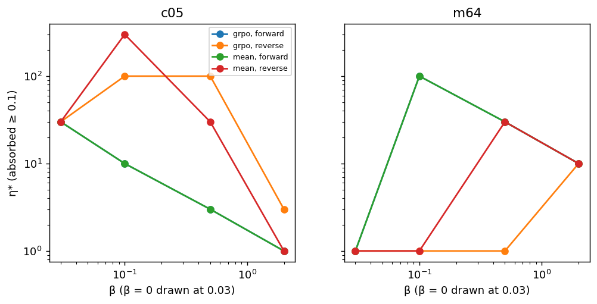

Mean absorbed fraction over the η grid, by β:

| level | kl | β=0.0 | β=0.1 | β=0.5 | β=2.0 |
|---|---|---|---|---|---|
| c05 | forward | 0.138 | 0.282 | 0.391 | 0.476 |
| c05 | reverse | 0.138 | 0.102 | 0.117 | 0.309 |
| m64 | forward | 0.463 | 0.201 | 0.286 | 0.370 |
| m64 | reverse | 0.463 | 0.465 | 0.313 | 0.357 |

## H5: group size at a fixed budget and escape from low p₀ (3,528 runs)

BG = 256 samples per step, G from 2 to 128, 5000 steps, best η per configuration. Tabular runs set p₀ exactly; linear and MLP runs are trained down to p₀ on decoy answers first, so their measured starting mean is used. *Samples to target* = 256 × the first logged step with mean p ≥ 0.5.

Measured starting mean p by level (nominal p₀ in columns):

| level | 0.01 | 0.03 | 0.1 | 0.3 |
|---|---|---|---|---|
| tab | 0.010 | 0.030 | 0.100 | 0.300 |
| lin | 0.010 | 0.030 | 0.100 | 0.275 |
| m64 | 0.010 | 0.029 | 0.096 | 0.295 |

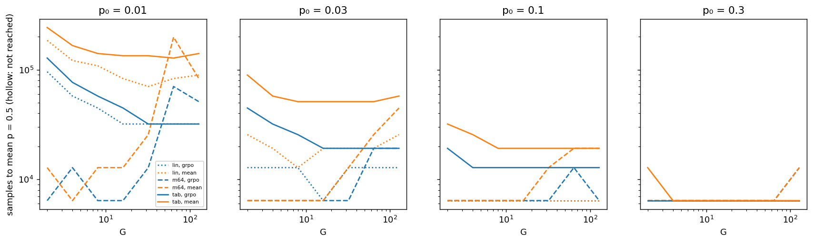

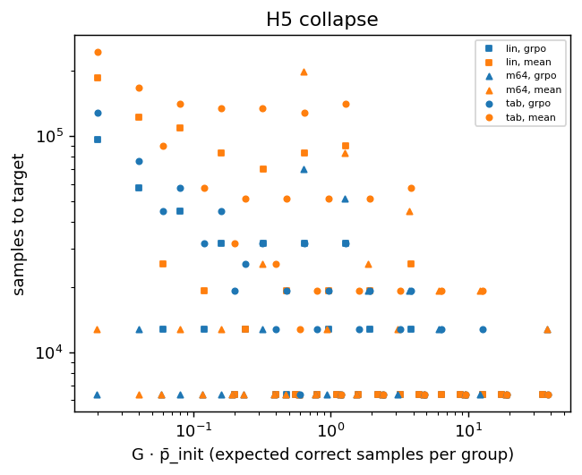

Best G (fewest samples to target) by p₀:

| level | rule | p₀=0.01 | p₀=0.03 | p₀=0.1 | p₀=0.3 |
|---|---|---|---|---|---|
| lin | grpo | 64 | 16 | 8 | 128 |
| lin | mean | 32 | 8 | 4 | 128 |
| m64 | grpo | 16 | 16 | 2 | 64 |
| m64 | mean | 4 | 16 | 2 | 64 |
| tab | grpo | 128 | 128 | 4 | 2 |
| tab | mean | 64 | 32 | 8 | 128 |

Sensitivity to G: max/min of samples-to-target over G (inf: some G never reached the target):

| level | rule | p₀=0.01 | p₀=0.03 | p₀=0.1 | p₀=0.3 |
|---|---|---|---|---|---|
| lin | grpo | 3.00 | 2.00 | 1.00 | 1.00 |
| lin | mean | 2.64 | 2.00 | 1.00 | 1.00 |
| m64 | grpo | 11.00 | 3.00 | 2.00 | 2.00 |
| m64 | mean | 31.00 | 7.00 | 3.00 | 2.00 |
| tab | grpo | 4.00 | 2.33 | 1.50 | 1.00 |
| tab | mean | 1.90 | 1.75 | 1.67 | 2.00 |

**Informative groups.** Measured share of groups with mixed rewards against the prediction mean_x φ(p_x) from the batch's own p (both averaged over training):

| level | measured | predicted | ratio |
|---|---|---|---|
| tab | 0.433 | 0.432 | 1.001 |
| lin | 0.223 | 0.223 | 1.000 |
| m64 | 0.075 | 0.075 | 1.001 |

Heterogeneity at the start: φ(p̄) − mean φ(p_x) is the extra share of all-same groups caused by spread in p (Nie et al.). Largest value over (level, G): 0.378.

Mean absorbed fraction over all η and G:

| level | rule | p₀=0.01 | p₀=0.03 | p₀=0.1 | p₀=0.3 |
|---|---|---|---|---|---|
| lin | grpo | 0.069 | 0.024 | 0.003 | 0.003 |
| lin | mean | 0.067 | 0.026 | 0.002 | 0.001 |
| m64 | grpo | 0.279 | 0.255 | 0.235 | 0.219 |
| m64 | mean | 0.265 | 0.199 | 0.180 | 0.155 |
| tab | grpo | 0.000 | 0.000 | 0.000 | 0.000 |
| tab | mean | 0.000 | 0.000 | 0.000 | 0.000 |

Samples are resolved only to 256 × 25 = 6,400 (the logging interval), which limits the ratios for fast configurations. The tabular mean-rule ratio reaches exactly 2.00 at p₀ = 0.3, on the boundary of the criterion.

**Verdict: PASS** (pre-registered: GRPO's best G falls as p₀ rises in tabular (Spearman -0.95) and the mean rule's samples-to-target vary by at most 2× over G (max 2.00))

