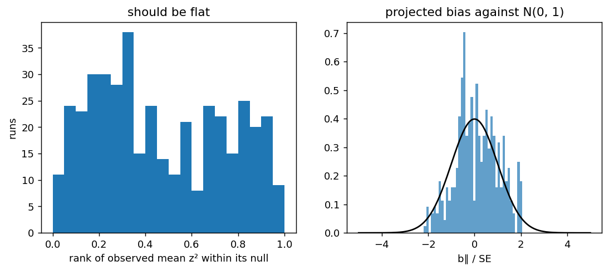
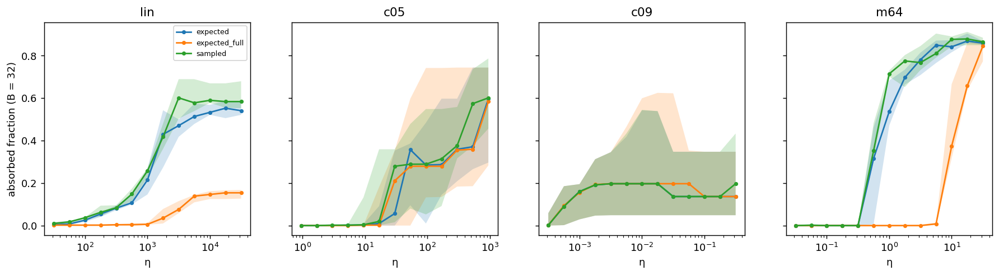
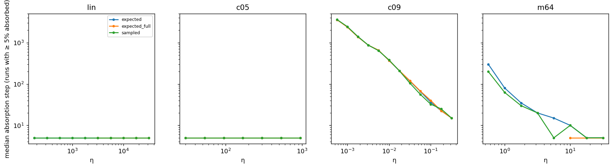
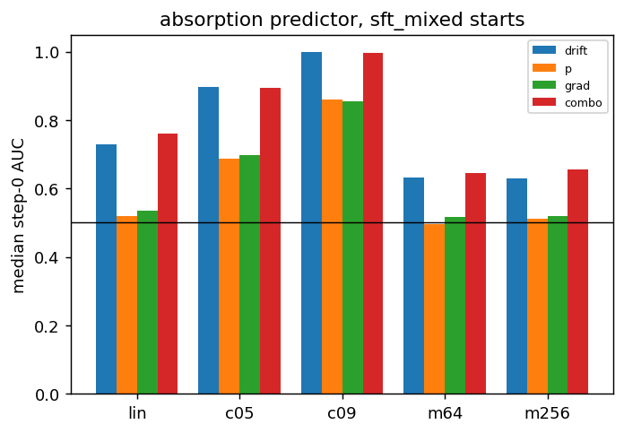
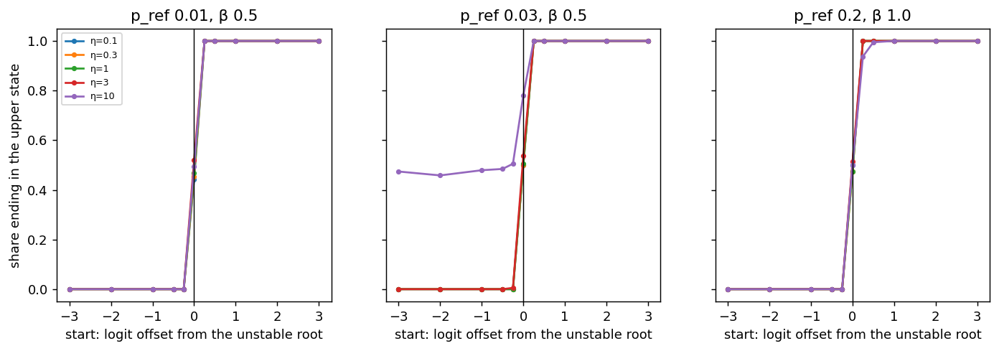

# Findings: stretch batch

Generated by `experiments/analyze.py`; every number below is recomputed from the raw results.

## Verdicts at a glance

| Test | Verdict |
|---|---|
| S_H1 Loose | PASS (per-rule median ratio ≤ 1.2 and median z² in [0.8, 1.25]; \|z\| > 3 share < 1%) |
| S_H1 Medium | FAIL (miss rate ≤ 0.08 (got 0.034) and no split with χ² p ≤ 0.01 (min p 0.004)) |
| S_H1 Tight | FAIL (every 95% CI inside ±2%, no \|b∥/SE\| > 3.9, pooled bias per rule within ±0.5%) |
| S_DRIFT 4 | FAIL (correlated features (c05, c09): at every η ≤ the base η* where sampled training absorbs ≥ 5%, the deterministic flow absorbs ≥ 0.8× as much, and its absorption time scales as η^s with s in [−1.2, −0.8]) |
| S_DRIFT 4 | PASS (m64: some η where sampled absorbs ≥ 10% while the deterministic flow absorbs < 2% (5 such η), and the sampled η* scales with B with slope in [0.6, 1.2] (got 0.83)) |
| S_PRED | PASS (drift beats the best single baseline by ≥ 0.05 AUC with a bootstrap CI above 0 on c05 and c09) |
| S_PRED | FAIL (on the MLPs step-0 drift does not beat the best baseline by 0.05) |
| S_PRED | FAIL (on the MLPs checkpoint drift predicts better than step-0 drift (bootstrap CI above 0)) |
| S_ABL | PASS (the control never lowers p, and every broken condition lowers p in at least one run) |
| S_EQ | PASS (at η ≤ 1 the upper-state share is < 0.1 for starts ≤ −0.5 logit and > 0.9 for starts ≥ +0.5 logit from the predicted unstable root) |
| S_EQ | PASS (end states within 0.01 of the predicted stable roots (median)) |
| S_EQ | FAIL (crossings increase with η in every setting (Spearman > 0)) |
| S_EQ | PASS (the mean-rule control ends at its single root from every start) |

## H1 re-run: loose, medium and tight tests (414 runs, R = 20,000)

Same 414 configurations as the base H1, with 5× the samples, split into 20 chunks. Two new statistics: the projected relative bias b∥ = (m − pred)·pred/‖pred‖² with an exact 1-D standard error, and for every run a null distribution of mean z² from 50 half-against-half splits of its own chunks (same coordinate correlation, no model involved).

### Loose: per-rule medians (the base criterion)

| rule | runs | median_ratio | median_z2 | frac_z_gt3 |
|---|---|---|---|---|
| grpo | 72 | 0.963 | 0.922 | 0.00199 |
| maxrl | 72 | 0.974 | 0.931 | 0.00225 |
| mean | 72 | 0.964 | 0.937 | 0.00216 |
| passk2 | 72 | 0.952 | 0.935 | 0.00213 |
| passk4 | 54 | 1.02 | 1.03 | 0.00345 |
| rloo | 72 | 0.964 | 0.937 | 0.00216 |

The base per-run band (ratio ≤ 1.2, z² in [0.8, 1.25]) is missed by 135 of 414 runs at R = 20,000 (base run, R = 4,000: 174).

**Verdict: PASS** (per-rule median ratio ≤ 1.2 and median z² in [0.8, 1.25]; |z| > 3 share < 1%)

### Medium: each run against its own calibrated null

Runs whose mean z² falls outside the central 95% of their own null: **14 of 414 (0.034)**. Expected under no bias: about 0.05 (a little more, since the 2.5/97.5% points come from 50 draws).

| split | chi2_p | miss_rate_by_group |
|---|---|---|
| rule | 0.941 | grpo: 0.03, maxrl: 0.03, mean: 0.03, passk2: 0.04, passk4: 0.06, rloo: 0.03 |
| level | 0.0416 | lin: 0.01, m64: 0.02, tab: 0.07 |
| G | 0.925 | 2: 0.02, 4: 0.04, 8: 0.04, 32: 0.04 |
| L | 0.00363 | 1: 0.07, 2: 0.00, 4: 0.03 |
| init | 0.863 | sft_up: 0.03, tabular: 0.03, uniform: 0.04 |

**Verdict: FAIL** (miss rate ≤ 0.08 (got 0.034) and no split with χ² p ≤ 0.01 (min p 0.004))

*Post hoc.* Bias can only make the error larger than its null, i.e. a *high* miss. High misses: **7 of 414 (0.017)**, below the 0.025 expected by chance. The split that fails is L: the L = 1 tabular runs have 7 *low* misses (error smaller than the null) and L = 2 has none at all, so the split-half null is somewhat too wide or too narrow depending on the configuration. That is a calibration limit of the null, not a sign of bias.

| L | level | high | inside | low |
|---|---|---|---|---|
| 1 | lin | 2 | 44 | 0 |
| 1 | m64 | 0 | 46 | 0 |
| 1 | tab | 1 | 38 | 7 |
| 2 | lin | 0 | 46 | 0 |
| 2 | m64 | 0 | 46 | 0 |
| 2 | tab | 0 | 46 | 0 |
| 4 | lin | 0 | 46 | 0 |
| 4 | m64 | 3 | 43 | 0 |
| 4 | tab | 1 | 45 | 0 |

### Tight: bound on the bias along the predicted direction

Runs whose 95% CI for b∥ leaves ±2%: **36**. Runs with |b∥/SE| > 3.9 (Bonferroni over 414 at 5%): **0**. Median CI half-width: 0.0025.

| rule | pooled_bias | pooled_se | max_abs_z |
|---|---|---|---|
| grpo | 0.0000 | 0.0000 | 2.0515 |
| maxrl | 0.0001 | 0.0001 | 2.0178 |
| mean | 0.0000 | 0.0001 | 2.0642 |
| passk2 | 0.0001 | 0.0000 | 2.0354 |
| passk4 | 0.0001 | 0.0001 | 2.1919 |
| rloo | 0.0000 | 0.0001 | 2.0642 |

| name | rule | G | L | level | init | bias_par | bias_par_se |
|---|---|---|---|---|---|---|---|
| s_h1/00276 | mean | 2 | 4 | tab | uniform | 0.00423 | 0.00834 |
| s_h1/00277 | rloo | 2 | 4 | tab | uniform | 0.00423 | 0.00834 |
| s_h1/00278 | grpo | 2 | 4 | tab | uniform | 0.00423 | 0.00834 |
| s_h1/00279 | maxrl | 2 | 4 | tab | uniform | 0.00423 | 0.00834 |
| s_h1/00280 | passk2 | 2 | 4 | tab | uniform | 0.00632 | 0.00796 |
| s_h1/00281 | mean | 4 | 4 | tab | uniform | -0.00981 | 0.00556 |
| s_h1/00282 | rloo | 4 | 4 | tab | uniform | -0.00981 | 0.00556 |
| s_h1/00283 | grpo | 4 | 4 | tab | uniform | -0.00983 | 0.00556 |
| s_h1/00284 | maxrl | 4 | 4 | tab | uniform | -0.00983 | 0.00556 |
| s_h1/00285 | passk2 | 4 | 4 | tab | uniform | -0.00963 | 0.0055 |
| s_h1/00286 | passk4 | 4 | 4 | tab | uniform | -0.00929 | 0.0055 |
| s_h1/00322 | mean | 2 | 4 | lin | uniform | 0.00661 | 0.00919 |
| s_h1/00323 | rloo | 2 | 4 | lin | uniform | 0.00661 | 0.00919 |
| s_h1/00324 | grpo | 2 | 4 | lin | uniform | 0.00661 | 0.00919 |
| s_h1/00325 | maxrl | 2 | 4 | lin | uniform | 0.00661 | 0.00919 |
| s_h1/00327 | mean | 4 | 4 | lin | uniform | 0.00988 | 0.00616 |
| s_h1/00328 | rloo | 4 | 4 | lin | uniform | 0.00988 | 0.00616 |
| s_h1/00329 | grpo | 4 | 4 | lin | uniform | 0.00978 | 0.00616 |
| s_h1/00330 | maxrl | 4 | 4 | lin | uniform | 0.00952 | 0.00616 |
| s_h1/00331 | passk2 | 4 | 4 | lin | uniform | 0.00883 | 0.00605 |
| s_h1/00368 | mean | 2 | 4 | m64 | uniform | -0.00935 | 0.0155 |
| s_h1/00369 | rloo | 2 | 4 | m64 | uniform | -0.00935 | 0.0155 |
| s_h1/00370 | grpo | 2 | 4 | m64 | uniform | -0.00935 | 0.0155 |
| s_h1/00371 | maxrl | 2 | 4 | m64 | uniform | -0.00935 | 0.0155 |
| s_h1/00372 | passk2 | 2 | 4 | m64 | uniform | -0.0138 | 0.013 |
| s_h1/00373 | mean | 4 | 4 | m64 | uniform | 0.00251 | 0.00984 |
| s_h1/00374 | rloo | 4 | 4 | m64 | uniform | 0.00251 | 0.00984 |
| s_h1/00375 | grpo | 4 | 4 | m64 | uniform | 0.00248 | 0.00982 |
| s_h1/00376 | maxrl | 4 | 4 | m64 | uniform | 0.00236 | 0.00983 |
| s_h1/00377 | passk2 | 4 | 4 | m64 | uniform | 0.00242 | 0.00945 |
| s_h1/00379 | mean | 8 | 4 | m64 | uniform | 0.00857 | 0.00675 |
| s_h1/00380 | rloo | 8 | 4 | m64 | uniform | 0.00857 | 0.00675 |
| s_h1/00381 | grpo | 8 | 4 | m64 | uniform | 0.00871 | 0.00669 |
| s_h1/00382 | maxrl | 8 | 4 | m64 | uniform | 0.00887 | 0.00668 |
| s_h1/00383 | passk2 | 8 | 4 | m64 | uniform | 0.00843 | 0.00663 |
| s_h1/00384 | passk4 | 8 | 4 | m64 | uniform | 0.00784 | 0.00655 |

**Verdict: FAIL** (every 95% CI inside ±2%, no |b∥/SE| > 3.9, pooled bias per rule within ±0.5%)

*Post hoc.* The ±2% bound fails for lack of precision, not because of bias: every run outside it is at L = 4 with uniform starts (p ≈ 0.012, so few samples carry signal), L 4 uniform: 36; their |b∥| is at most 0.014 and their |z| at most 1.77. Across all 414 runs the largest |b∥/SE| is 2.19 and the pooled bias per rule is within ±0.0001. The rules share samples within a configuration, so these runs are not independent.

## H3 stretch: interference drift against step noise (2,340 runs)

Each configuration is trained three ways: *sampled* (ordinary GRPO), *expected* (the exact expected step on the sampled prompt batch: no response-sampling noise) and *expected_full* (the exact expected step on all 512 prompts: a deterministic flow). L = 2, GRPO, G = 8, 5000 steps, 5 seeds, 13 η per level centred on the base η*.

### 1: Absorbed fraction by update mode

| level | eta | expected | expected_full | sampled |
|---|---|---|---|---|
| c05 | 0.949 | 0 | 0 | 0 |
| c05 | 1.69 | 0 | 0 | 0 |
| c05 | 3 | 0 | 0 | 0.00195 |
| c05 | 5.33 | 0.00195 | 0 | 0.00195 |
| c05 | 9.49 | 0.00195 | 0.00195 | 0.00391 |
| c05 | 16.9 | 0.00977 | 0.00195 | 0.0195 |
| c05 | 30 | 0.0566 | 0.211 | 0.279 |
| c05 | 53.4 | 0.357 | 0.279 | 0.289 |
| c05 | 94.9 | 0.285 | 0.279 | 0.289 |
| c05 | 169 | 0.287 | 0.279 | 0.314 |
| c05 | 300 | 0.359 | 0.355 | 0.377 |
| c05 | 534 | 0.371 | 0.359 | 0.574 |
| c05 | 949 | 0.598 | 0.584 | 0.602 |
| c09 | 0.000316 | 0.00195 | 0.00195 | 0.00195 |
| c09 | 0.000562 | 0.0918 | 0.0938 | 0.0898 |
| c09 | 0.001 | 0.16 | 0.156 | 0.16 |
| c09 | 0.00178 | 0.191 | 0.193 | 0.191 |
| c09 | 0.00316 | 0.197 | 0.197 | 0.197 |
| c09 | 0.00562 | 0.197 | 0.197 | 0.197 |
| c09 | 0.01 | 0.197 | 0.197 | 0.197 |
| c09 | 0.0178 | 0.197 | 0.197 | 0.197 |
| c09 | 0.0316 | 0.137 | 0.197 | 0.137 |
| c09 | 0.0562 | 0.137 | 0.197 | 0.137 |
| c09 | 0.1 | 0.137 | 0.137 | 0.137 |
| c09 | 0.178 | 0.137 | 0.137 | 0.137 |
| c09 | 0.316 | 0.137 | 0.137 | 0.197 |
| lin | 31.6 | 0.00391 | 0.00195 | 0.00977 |
| lin | 56.2 | 0.00781 | 0.00195 | 0.0176 |
| lin | 100 | 0.0254 | 0.00195 | 0.0371 |
| lin | 178 | 0.0547 | 0.00195 | 0.0625 |
| lin | 316 | 0.082 | 0.00391 | 0.084 |
| lin | 562 | 0.107 | 0.00391 | 0.148 |
| lin | 1e+03 | 0.215 | 0.00586 | 0.258 |
| lin | 1.78e+03 | 0.43 | 0.0352 | 0.418 |
| lin | 3.16e+03 | 0.471 | 0.0762 | 0.602 |
| lin | 5.62e+03 | 0.514 | 0.139 | 0.578 |
| lin | 1e+04 | 0.533 | 0.146 | 0.59 |
| lin | 1.78e+04 | 0.553 | 0.154 | 0.584 |
| lin | 3.16e+04 | 0.541 | 0.154 | 0.584 |
| m64 | 0.0316 | 0 | 0 | 0 |
| m64 | 0.0562 | 0 | 0 | 0.00195 |
| m64 | 0.1 | 0 | 0 | 0 |
| m64 | 0.178 | 0 | 0 | 0 |
| m64 | 0.316 | 0 | 0 | 0 |
| m64 | 0.562 | 0.316 | 0 | 0.354 |
| m64 | 1 | 0.537 | 0 | 0.715 |
| m64 | 1.78 | 0.697 | 0 | 0.775 |
| m64 | 3.16 | 0.781 | 0 | 0.768 |
| m64 | 5.62 | 0.85 | 0.00781 | 0.811 |
| m64 | 10 | 0.842 | 0.375 | 0.877 |
| m64 | 17.8 | 0.869 | 0.658 | 0.879 |
| m64 | 31.6 | 0.859 | 0.846 | 0.865 |

### 2: Time to absorption

| level | update | points | t50_slope |
|---|---|---|---|
| lin | expected | 10 | 6.1e-17 |
| lin | expected_full | 5 | 4.95e-17 |
| lin | sampled | 10 | 6.1e-17 |
| c05 | expected | 7 | 3.68e-17 |
| c05 | expected_full | 7 | 3.68e-17 |
| c05 | sampled | 7 | 3.68e-17 |
| c09 | expected | 12 | -0.891 |
| c09 | expected_full | 12 | -0.884 |
| c09 | sampled | 12 | -0.898 |
| m64 | expected | 8 | -0.964 |
| m64 | expected_full | 3 | 2.53e-16 |
| m64 | sampled | 8 | -0.892 |

A slope of −1 means the time scales as 1/η (deterministic drift); a much steeper or threshold-like curve means escape driven by noise.

*Post hoc.* Median absorption step (log resolution 5 steps) over runs with ≥ 5% absorbed. A slope of 0 above is not a scaling result: in lin and c05 every absorption happens within the first 5 steps, a one-shot overshoot by a large step. Only c09 absorbs slowly (hundreds to thousands of steps).

| level | update | count | min | median | max |
|---|---|---|---|---|---|
| c05 | expected | 33 | 5 | 5 | 5 |
| c05 | expected_full | 33 | 5 | 5 | 5 |
| c05 | sampled | 37 | 5 | 5 | 10 |
| c09 | expected | 48 | 5 | 307.5 | 4392 |
| c09 | expected_full | 48 | 5 | 316.2 | 4405 |
| c09 | sampled | 48 | 5 | 327.5 | 4388 |
| lin | expected | 48 | 5 | 5 | 10 |
| lin | expected_full | 27 | 5 | 5 | 5 |
| lin | sampled | 49 | 5 | 5 | 5 |
| m64 | expected | 39 | 5 | 15 | 350 |
| m64 | expected_full | 15 | 5 | 5 | 5 |
| m64 | sampled | 40 | 5 | 12.5 | 250 |

### 3: Threshold against B

| level | update | B=8 | B=32 | B=128 |
|---|---|---|---|---|
| c05 | expected | 30 | 53.4 | 53.4 |
| c05 | sampled | 16.9 | 30 | 53.4 |
| c09 | expected | 0.001 | 0.001 | 0.001 |
| c09 | sampled | 0.001 | 0.001 | 0.001 |
| lin | expected | 100 | 562 | 1.78e+03 |
| lin | sampled | 56.2 | 562 | 1.78e+03 |
| m64 | expected | 0.178 | 0.562 | 1.78 |
| m64 | sampled | 0.178 | 0.562 | 1.78 |

Slope of log η* against log B: c05 expected: 0.21, c05 sampled: 0.42, c09 expected: -0.00, c09 sampled: -0.00, lin expected: 1.04, lin sampled: 1.25, m64 expected: 0.83, m64 sampled: 0.83. Noise predicts 1 (s̄ ∝ η/B); drift predicts 0.

### 4: Drift share

| level | η with sampled ≥ 5% absorbed | median share present without noise | min share |
|---|---|---|---|
| lin | 10 | 0.105 | 0.0227 |
| c05 | 7 | 0.943 | 0.626 |
| c09 | 12 | 1 | 0.693 |
| m64 | 8 | 0.00482 | 0 |

**Verdict: FAIL** (correlated features (c05, c09): at every η ≤ the base η* where sampled training absorbs ≥ 5%, the deterministic flow absorbs ≥ 0.8× as much, and its absorption time scales as η^s with s in [−1.2, −0.8])

**Verdict: PASS** (m64: some η where sampled absorbs ≥ 10% while the deterministic flow absorbs < 2% (5 such η), and the sampled η* scales with B with slope in [0.6, 1.2] (got 0.83))

### 5: Adam

| level | eta | expected_full | sampled |
|---|---|---|---|
| c05 | 0.0001 | 0.00586 | 0.00391 |
| c05 | 0.000178 | 0.00781 | 0.0137 |
| c05 | 0.000316 | 0 | 0.0254 |
| c05 | 0.000562 | 0 | 0.0137 |
| c05 | 0.001 | 0 | 0 |
| c05 | 0.00178 | 0 | 0 |
| c05 | 0.00316 | 0 | 0 |
| c05 | 0.00562 | 0 | 0 |
| c05 | 0.01 | 0 | 0 |
| c05 | 0.0178 | 0 | 0 |
| c05 | 0.0316 | 0.00195 | 0 |
| c05 | 0.0562 | 0.00195 | 0 |
| c05 | 0.1 | 0.00195 | 0.00391 |
| c09 | 0.0001 | 0.117 | 0.186 |
| c09 | 0.000178 | 0.137 | 0.127 |
| c09 | 0.000316 | 0.104 | 0.135 |
| c09 | 0.000562 | 0.105 | 0.105 |
| c09 | 0.001 | 0.105 | 0.105 |
| c09 | 0.00178 | 0.104 | 0.105 |
| c09 | 0.00316 | 0.0488 | 0.105 |
| c09 | 0.00562 | 0.0488 | 0.105 |
| c09 | 0.01 | 0.0488 | 0.105 |
| c09 | 0.0178 | 0.0488 | 0.105 |
| c09 | 0.0316 | 0.0488 | 0.0488 |
| c09 | 0.0562 | 0.0488 | 0.105 |
| c09 | 0.1 | 0.141 | 0.197 |
| lin | 0.0001 | 0 | 0 |
| lin | 0.000178 | 0 | 0 |
| lin | 0.000316 | 0 | 0 |
| lin | 0.000562 | 0 | 0 |
| lin | 0.001 | 0 | 0 |
| lin | 0.00178 | 0 | 0 |
| lin | 0.00316 | 0 | 0 |
| lin | 0.00562 | 0 | 0 |
| lin | 0.01 | 0.00195 | 0 |
| lin | 0.0178 | 0.00195 | 0 |
| lin | 0.0316 | 0.00195 | 0 |
| lin | 0.0562 | 0.00195 | 0.00195 |
| lin | 0.1 | 0.00195 | 0.00391 |
| m64 | 0.0001 | 0 | 0 |
| m64 | 0.000178 | 0 | 0 |
| m64 | 0.000316 | 0 | 0 |
| m64 | 0.000562 | 0 | 0 |
| m64 | 0.001 | 0 | 0 |
| m64 | 0.00178 | 0 | 0.00195 |
| m64 | 0.00316 | 0 | 0.00391 |
| m64 | 0.00562 | 0 | 0.00781 |
| m64 | 0.01 | 0 | 0.109 |
| m64 | 0.0178 | 0 | 0.418 |
| m64 | 0.0316 | 0.00391 | 0.674 |
| m64 | 0.0562 | 0.381 | 0.875 |
| m64 | 0.1 | 0.645 | 0.824 |

## H3 stretch: per-prompt absorption predictor (800 runs)

Within-run AUC for which prompts get absorbed. Scores: −d_x (predicted first-order drift), −d_x/(p(1−p)), −p_x, −‖∇p_x‖, and a 5-fold cross-validated logistic model on (log p_x, drift). *Step 0*: absorbed at any later time. *Checkpoints*: absorbed within the next 500 steps, averaged over checkpoints. *sft_mixed* starts give a real spread of p; uniform starts give every prompt the same p, so the p baseline is 0.5 there by construction.

Median spread (sd) of starting p by level and init: c05: sft_mixed 0.12, uniform 0.00; c09: sft_mixed 0.09, uniform 0.00; lin: sft_mixed 0.15, uniform 0.00; m256: sft_mixed 0.37, uniform 0.00; m64: sft_mixed 0.30, uniform 0.00

Step-0 AUCs (median over runs):

| level | init | runs_scored | step0_drift | step0_logit_drift | step0_p | step0_grad | step0_combo |
|---|---|---|---|---|---|---|---|
| lin | sft_mixed | 80 | 0.729 | 0.756 | 0.520 | 0.536 | 0.760 |
| c05 | sft_mixed | 80 | 0.897 | 0.898 | 0.686 | 0.697 | 0.894 |
| c09 | sft_mixed | 46 | 0.999 | 0.997 | 0.861 | 0.854 | 0.996 |
| m64 | sft_mixed | 62 | 0.633 | 0.666 | 0.495 | 0.517 | 0.645 |
| m256 | sft_mixed | 60 | 0.629 | 0.672 | 0.511 | 0.518 | 0.656 |
| lin | uniform | 80 | 0.764 | 0.764 | 0.500 | 0.501 | 0.757 |
| c05 | uniform | 80 | 0.870 | 0.870 | 0.500 | 0.499 | 0.868 |
| c09 | uniform | 62 | 1.000 | 1.000 | 0.500 | 0.509 | 1.000 |
| m64 | uniform | 65 | 0.620 | 0.620 | 0.500 | 0.495 | 0.632 |
| m256 | uniform | 58 | 0.609 | 0.609 | 0.500 | 0.480 | 0.645 |

Checkpoint AUCs (absorbed within the next 500 steps; median over runs):

| level | init | ck_drift | ck_logit_drift | ck_p | ck_grad | ck_combo |
|---|---|---|---|---|---|---|
| lin | sft_mixed | 0.509 | 0.509 | 0.506 | 0.474 | 0.458 |
| c05 | sft_mixed | 0.517 | 0.527 | 0.658 | 0.230 | 0.508 |
| c09 | sft_mixed | 0.893 | 0.989 | 1.000 | 0.996 | 0.999 |
| m64 | sft_mixed | 0.502 | 0.502 | 0.496 | 0.497 | 0.463 |
| m256 | sft_mixed | 0.498 | 0.498 | 0.498 | 0.491 | 0.466 |
| lin | uniform | 0.496 | 0.496 | 0.499 | 0.473 | 0.465 |
| c05 | uniform | 0.509 | 0.511 | 0.558 | 0.258 | 0.513 |
| c09 | uniform | 0.825 | 1.000 | 1.000 | 0.932 | 0.999 |
| m64 | uniform | 0.502 | 0.502 | 0.499 | 0.498 | 0.476 |
| m256 | uniform | 0.505 | 0.505 | 0.505 | 0.478 | 0.476 |

| level | best_baseline | runs | drift_minus_baseline | ci_lo | ci_hi | ck_minus_step0 | ck_ci_lo | ck_ci_hi |
|---|---|---|---|---|---|---|---|---|
| lin | grad | 80 | 0.189 | 0.159 | 0.206 | -0.256 | -0.266 | -0.216 |
| c05 | grad | 80 | 0.172 | 0.153 | 0.205 | -0.289 | -0.415 | -0.16 |
| c09 | p | 46 | 0.136 | 0.0559 | 0.145 | -0.105 | -0.213 | -0.0402 |
| m64 | grad | 62 | 0.107 | 0.0686 | 0.157 | -0.153 | -0.199 | -0.108 |
| m256 | grad | 60 | 0.0963 | 0.0404 | 0.141 | -0.154 | -0.227 | -0.122 |

**Verdict: PASS** (drift beats the best single baseline by ≥ 0.05 AUC with a bootstrap CI above 0 on c05 and c09)

**Verdict: FAIL** (on the MLPs step-0 drift does not beat the best baseline by 0.05)

**Verdict: FAIL** (on the MLPs checkpoint drift predicts better than step-0 drift (bootstrap CI above 0))

## H3 stretch: ablations of the tabular proposition (558 runs)

Tabular, starting p spread over logits in [−4, 3], GRPO, B = 32, 5000 steps; one condition of the proposition broken at a time. *max drop* = largest p_init − min p over prompts.

| ablation | runs | runs_with_decreases | median_decreases | max_drop | mean_absorbed | max_absorbed | mean_final |
|---|---|---|---|---|---|---|---|
| control | 72 | 0 | 0 | 0 | 0 | 0 | 0.881 |
| flip05 | 72 | 72 | 1.45e+03 | 0.75 | 0.0162 | 0.15 | 0.859 |
| flip20 | 72 | 72 | 8.41e+03 | 0.946 | 0.0422 | 0.352 | 0.806 |
| momentum | 72 | 44 | 1.5 | 0 | 0 | 0 | 0.99 |
| adam | 54 | 49 | 4 | 0 | 0 | 0 | 0.895 |
| kl01 | 72 | 72 | 1.26e+05 | 0 | 0 | 0 | 0.877 |
| kl1 | 72 | 72 | 9.15e+04 | 0.455 | 0.0136 | 0.17 | 0.69 |
| sign | 72 | 69 | 932 | 0.433 | 0.0242 | 0.266 | 0.86 |

Largest drop and absorbed fraction by L:

| ablation | max_absorbed L=1 | max_absorbed L=2 | max_absorbed L=4 | max_drop L=1 | max_drop L=2 | max_drop L=4 |
|---|---|---|---|---|---|---|
| control | 0.000 | 0.000 | 0.000 | 0.000 | 0.000 | 0.000 |
| flip05 | 0.016 | 0.092 | 0.150 | 0.346 | 0.587 | 0.750 |
| flip20 | 0.059 | 0.211 | 0.352 | 0.910 | 0.906 | 0.946 |
| momentum | 0.000 | 0.000 | 0.000 | 0.000 | 0.000 | 0.000 |
| adam | 0.000 | 0.000 | 0.000 | 0.000 | 0.000 | 0.000 |
| kl01 | 0.000 | 0.000 | 0.000 | 0.000 | 0.000 | 0.000 |
| kl1 | 0.170 | 0.037 | 0.002 | 0.455 | 0.233 | 0.144 |
| sign | 0.006 | 0.096 | 0.266 | 0.128 | 0.414 | 0.433 |

By η (largest drop / largest absorbed fraction):

| ablation | 0.001 | 0.01 | 0.1 | 0.3 | 3.0 | 30.0 | 300.0 |
|---|---|---|---|---|---|---|---|
| control | nan | nan | nan | 0.000 / 0.000 | 0.000 / 0.000 | 0.000 / 0.000 | 0.000 / 0.000 |
| flip05 | nan | nan | nan | 0.001 / 0.000 | 0.009 / 0.000 | 0.116 / 0.006 | 0.750 / 0.150 |
| flip20 | nan | nan | nan | 0.003 / 0.000 | 0.029 / 0.002 | 0.207 / 0.051 | 0.946 / 0.352 |
| momentum | nan | nan | nan | 0.000 / 0.000 | 0.000 / 0.000 | 0.000 / 0.000 | 0.000 / 0.000 |
| adam | 0.000 / 0.000 | 0.000 / 0.000 | 0.000 / 0.000 | nan | nan | nan | nan |
| kl01 | nan | nan | nan | 0.000 / 0.000 | 0.000 / 0.000 | 0.000 / 0.000 | 0.000 / 0.000 |
| kl1 | nan | nan | nan | 0.000 / 0.000 | 0.000 / 0.000 | 0.001 / 0.000 | 0.455 / 0.170 |
| sign | nan | nan | nan | 0.001 / 0.000 | 0.010 / 0.000 | 0.089 / 0.031 | 0.433 / 0.266 |

**Verdict: PASS** (the control never lowers p, and every broken condition lowers p in at least one run)

## H4 stretch: two stable KL fixed points (594 runs)

GRPO with KL(π‖π_ref), G = 64, tabular, 64 identical prompts per run (64 replicates). The policy starts at p_start, a logit offset from the predicted unstable root, while the reference stays at p_ref. A crossing is a replicate passing the unstable root between snapshots (every 100 steps).

| p0 | beta | eta | -3.0 | -2.0 | -1.0 | -0.5 | -0.25 | 0.0 | 0.25 | 0.5 | 1.0 | 2.0 | 3.0 |
|---|---|---|---|---|---|---|---|---|---|---|---|---|---|
| 0.01 | 0.50 | 0.10 | 0.00 | 0.00 | 0.00 | 0.00 | 0.00 | 0.44 | 1.00 | 1.00 | 1.00 | 1.00 | 1.00 |
| 0.01 | 0.50 | 0.30 | 0.00 | 0.00 | 0.00 | 0.00 | 0.00 | 0.45 | 1.00 | 1.00 | 1.00 | 1.00 | 1.00 |
| 0.01 | 0.50 | 1.00 | 0.00 | 0.00 | 0.00 | 0.00 | 0.00 | 0.47 | 1.00 | 1.00 | 1.00 | 1.00 | 1.00 |
| 0.03 | 0.50 | 0.10 | 0.00 | 0.00 | 0.00 | 0.00 | 0.00 | 0.50 | 1.00 | 1.00 | 1.00 | 1.00 | 1.00 |
| 0.03 | 0.50 | 0.30 | 0.00 | 0.00 | 0.00 | 0.00 | 0.00 | 0.50 | 1.00 | 1.00 | 1.00 | 1.00 | 1.00 |
| 0.03 | 0.50 | 1.00 | 0.00 | 0.00 | 0.00 | 0.00 | 0.00 | 0.51 | 1.00 | 1.00 | 1.00 | 1.00 | 1.00 |
| 0.20 | 1.00 | 0.10 | 0.00 | 0.00 | 0.00 | 0.00 | 0.00 | 0.50 | 1.00 | 1.00 | 1.00 | 1.00 | 1.00 |
| 0.20 | 1.00 | 0.30 | 0.00 | 0.00 | 0.00 | 0.00 | 0.00 | 0.47 | 1.00 | 1.00 | 1.00 | 1.00 | 1.00 |
| 0.20 | 1.00 | 1.00 | 0.00 | 0.00 | 0.00 | 0.00 | 0.00 | 0.47 | 1.00 | 1.00 | 1.00 | 1.00 | 1.00 |

Mean crossings per run (64 replicates, 10,000 steps):

| p0 | beta | 0.1 | 0.3 | 1.0 | 3.0 | 10.0 |
|---|---|---|---|---|---|---|
| 0.0 | 0.5 | 26.7 | 18.3 | 9.5 | 5.2 | 3.2 |
| 0.0 | 0.5 | 35.4 | 29.9 | 19.2 | 14.8 | 43.2 |
| 0.2 | 1.0 | 29.3 | 25.4 | 14.8 | 8.2 | 5.5 |

End states at η ≤ 1: median |error| to the lower root 0.0025 (max 0.5363), to the upper root 0.0075 (max 0.2417).

Mean-rule control (single predicted root): 1 stable root(s); share of runs ending within 0.01 of it: 1.00.

**Verdict: PASS** (at η ≤ 1 the upper-state share is < 0.1 for starts ≤ −0.5 logit and > 0.9 for starts ≥ +0.5 logit from the predicted unstable root)

**Verdict: PASS** (end states within 0.01 of the predicted stable roots (median))

**Verdict: FAIL** (crossings increase with η in every setting (Spearman > 0))

*Post hoc.* The crossing count above is dominated by replicates started at the unstable root (offset 0) slowly leaving it, which is slower at small η. Switching between the two stable states, counted in the second half of training for starts away from the unstable root (total over runs):

| p0 | beta | 0.1 | 0.3 | 1.0 | 3.0 | 10.0 |
|---|---|---|---|---|---|---|
| 0.01 | 0.5 | 0 | 0 | 0 | 0 | 0 |
| 0.03 | 0.5 | 0 | 0 | 0 | 6 | 538 |
| 0.2 | 1 | 0 | 0 | 0 | 0 | 0 |

Noise-driven switching appears only where the barrier is small (p_ref 0.03: stable 0.699, unstable 0.757) and grows steeply with η, as a barrier-crossing picture predicts.

**Verdict: PASS** (the mean-rule control ends at its single root from every start)

