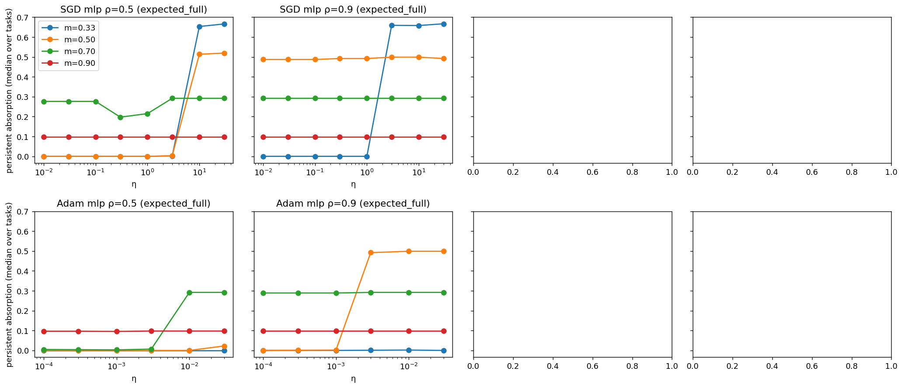

# Findings: v3 batch 2 (pre-registered in PREREG_v3b.md)

Generated by `experiments/analyze_v3b.py`; every number below is recomputed from the raw results.

## Verdicts at a glance

| Test | Verdict |
|---|---|
| V3_T5 | FAIL (ΔAUC 0.009 (need ≥ 0.03) with CI lower bound 0.004 (need > 0)) |
| V3_T7 | PASS (tabular calibration KS p = 0.73; medium tier applied to lin and m64 above) |
| V3_T9 | FAIL (t1-minority: heckel lower than grpo in every cell: False; virtual and pm_alpha within ±0.02 of grpo: True; nsr and mean not lower than grpo: True) |
| V3_T1S1 | PASS (SGD cells 4/4 pass, Adam cells 4/4 pass; pre-registered rule) |
| V3_T2G | PASS (Spearman(G, excess) = -0.33, one-sided p = 5.48e-10 (prediction: < 0)) |
| V3_T6KL | PASS (no material drop below p_init at η ≤ 3 for KL: True; control has no decline from a peak: True; drops below p_init only at η ≥ 30: True) |

## P3 (T5): does the initial drift predict absorption on balanced tasks?

Runs with ≥ 20 absorbed and ≥ 20 non-absorbed eligible prompts: 137 of 200 (by level: {'m64': 44, 'lin': 42, 'c09': 38, 'c05': 13}).

Within-run AUC (leave-one-task-out): base (rarity + logit p_init) 0.558, full (+ drift) 0.567; ΔAUC = 0.009, 95% CI [0.004, 0.014] (10,000 task bootstraps of the held-out scores). Single predictors (sign chosen so higher = more absorption): rarity 0.543, logit p_init 0.455, drift 0.639.

| level | runs | auc_base | auc_full | delta |
|---|---|---|---|---|
| lin | 42 | 0.573 | 0.588 | 0.0158 |
| c05 | 13 | 0.617 | 0.635 | 0.0181 |
| c09 | 38 | 0.571 | 0.579 | 0.00797 |
| m64 | 44 | 0.517 | 0.518 | 0.00104 |

P-value passed to Holm: 0.0001.

**Verdict: FAIL** (ΔAUC 0.009 (need ≥ 0.03) with CI lower bound 0.004 (need > 0))

**Post-hoc sensitivity (not pre-registered, does not change the verdict):** with every predictor standardised within its run (drift scales with η, which spans 100× across runs), base AUC 0.557, full 0.637, ΔAUC = 0.079, 95% CI [0.036, 0.120] (2,000 task bootstraps).

Implementation note: run fixed effects cannot be predicted for held-out tasks, so AUC is computed within runs (pairs from the same run), where the run intercept cancels; the bootstrap resamples tasks over held-out scores without refitting. Both are reported as clarifications of the pre-registration.

## T7 (exploratory): calibrated H1 medium tier

Rank of the observed mean z² within its 200 bootstrap draws; under the exact identity the ranks are Uniform(0, 1) and 5% exceed 0.95.

| level | runs | median_rank | share_above_095 | ks_p |
|---|---|---|---|---|
| lin | 80 | 0.49 | 0.0875 | 0.835 |
| m64 | 80 | 0.52 | 0.0375 | 0.0554 |
| tab | 80 | 0.508 | 0.0375 | 0.73 |

**Verdict: PASS** (tabular calibration KS p = 0.73; medium tier applied to lin and m64 above)

## T9 (exploratory): all-wrong-group fixes

Mean persistent absorption (τ = 1e-3) per rule over 10 tasks or seeds; one-sided paired Wilcoxon for heckel < grpo.

| cell | grpo | mean | heckel | virtual | pm_alpha | nsr | heckel<grpo p |
|---|---|---|---|---|---|---|---|
| t1-minority / expected_full / η=0.1 | 0.102 | 0.0926 | 0.0594 | 0.102 | 0.102 | 0.0953 | 0.00195 |
| t1-minority / expected_full / η=1 | 0.103 | 0.103 | 0.102 | 0.103 | 0.103 | 0.103 | 0.5 |
| t1-minority / sampled / η=0.1 | 0.102 | 0.0926 | 0.0652 | 0.102 | 0.102 | 0.0953 | 0.00195 |
| t1-minority / sampled / η=1 | 0.103 | 0.103 | 0.103 | 0.103 | 0.103 | 0.103 | 0.5 |
| t2-kick / expected / η=300 | 0.211 | 0.0686 | 0.416 | 0.311 | 0.295 | 0.155 | 1 |
| t2-kick / sampled / η=300 | 0.383 | 0.135 | 0.439 | 0.352 | 0.347 | 0.336 | 0.903 |
| t6-flip20 / sampled / η=30 | 0 | 0 | 0 | 0 | 0 | 0 | 1 |
| t6-flip20 / sampled / η=300 | 0.00957 | 0 | 0.0494 | 0.0082 | 0.00879 | 0.00488 | 1 |

| rule | absorbed_minority_frac |
|---|---|
| grpo | 1 |
| heckel | 1 |
| mean | 1 |
| nsr | 1 |
| pm_alpha | 1 |
| virtual | 1 |

**Verdict: FAIL** (t1-minority: heckel lower than grpo in every cell: False; virtual and pm_alpha within ±0.02 of grpo: True; nsr and mean not lower than grpo: True)

## Follow-up (a): T1 MLP cells with init seed 1

## P1 (T1): absorption rises with majority share at fixed geometry

No-overshoot η set per cell: the η at which the balanced arm (m = 1/3) has median persistent absorption ≤ 0.02 over the 10 task seeds. Absorption is the persistent fraction at τ = 1e-3. Means are over (task, η) in that set.

| arch | rho | optimizer | update | n_eta | etas | abs_bal | abs_m07 | abs_m09 | wilcoxon_p | spearman | spearman_p | passed |
|---|---|---|---|---|---|---|---|---|---|---|---|---|
| mlp | 0.5 | adam | expected_full | 6 | 0.0001,0.0003,0.001,0.003,0.01,0.03 | 0.000488 | 0.146 | 0.0909 | 6.9e-12 | 0.698 | 1.25e-36 | True |
| mlp | 0.5 | adam | sampled | 5 | 0.0001,0.0003,0.001,0.003,0.01 | 0.000469 | 0.185 | 0.0979 | 3.25e-10 | 0.709 | 3.66e-32 | True |
| mlp | 0.5 | sgd | expected_full | 6 | 0.01,0.03,0.1,0.3,1,3 | 0.0226 | 0.215 | 0.102 | 2.11e-09 | 0.604 | 1.4e-25 | True |
| mlp | 0.5 | sgd | sampled | 5 | 0.01,0.03,0.1,0.3,1 | 0.000117 | 0.236 | 0.102 | 3.33e-10 | 0.666 | 2.97e-27 | True |
| mlp | 0.9 | adam | expected_full | 6 | 0.0001,0.0003,0.001,0.003,0.01,0.03 | 0.00579 | 0.264 | 0.101 | 1.33e-10 | 0.382 | 4.47e-10 | True |
| mlp | 0.9 | adam | sampled | 5 | 0.0001,0.0003,0.001,0.003,0.01 | 0 | 0.291 | 0.103 | 2.87e-10 | 0.401 | 2.01e-09 | True |
| mlp | 0.9 | sgd | expected_full | 5 | 0.01,0.03,0.1,0.3,1 | 0.0264 | 0.294 | 0.103 | 8.28e-08 | 0.198 | 0.00248 | True |
| mlp | 0.9 | sgd | sampled | 4 | 0.01,0.03,0.1,0.3 | 0 | 0.294 | 0.103 | 1.43e-08 | 0.245 | 0.000906 | True |

P-value passed to Holm (largest Wilcoxon p over included cells): 8.28e-08.

**Verdict: PASS** (SGD cells 4/4 pass, Adam cells 4/4 pass; pre-registered rule)

### Descriptive: absorption by majority share and η

### Descriptive: who is absorbed

Pooled over all runs with any persistent absorption (all η, both optimizers and updates). `minority_share` is the share of prompts whose answer is a minority class.

| m | runs | absorbed | minority | minority_share | absorbed_minority_frac |
|---|---|---|---|---|---|
| 0.333 | 184 | 44038 | 27658 | 0.679 | 0.628 |
| 0.5 | 362 | 76309 | 73231 | 0.497 | 0.96 |
| 0.7 | 528 | 71931 | 71928 | 0.294 | 1 |
| 0.9 | 560 | 28866 | 28866 | 0.103 | 1 |

Median over runs with absorption of (absorbed fraction ÷ minority share); 1 means the whole minority set is absorbed.

| m | optimizer | mean_ratio |
|---|---|---|
| 0.5 | adam | 1 |
| 0.5 | sgd | 1 |
| 0.7 | adam | 1 |
| 0.7 | sgd | 1 |
| 0.9 | adam | 1 |
| 0.9 | sgd | 1 |

### Descriptive: supervised control (cross-entropy, η = 1, 2,000 steps)

| arch | rho | m | persist | final_mean |
|---|---|---|---|---|
| mlp | 0.5 | 0.333 | 0 | 1 |
| mlp | 0.5 | 0.5 | 0 | 1 |
| mlp | 0.5 | 0.7 | 0 | 1 |
| mlp | 0.5 | 0.9 | 0 | 1 |
| mlp | 0.9 | 0.333 | 0 | 0.335 |
| mlp | 0.9 | 0.5 | 0 | 0.381 |
| mlp | 0.9 | 0.7 | 0 | 0.63 |
| mlp | 0.9 | 0.9 | 0 | 0.821 |

### Descriptive: per-class margins (top score minus second, over the 10 tasks)

| rho | m | class | margin_q10 | margin_q50 | margin_q90 |
|---|---|---|---|---|---|
| 0.5 | 0.333 | class 0 | 0.33 | 1.83 | 5.24 |
| 0.5 | 0.333 | minority | 0.313 | 1.72 | 4.84 |
| 0.5 | 0.5 | class 0 | 0.431 | 2.18 | 6.05 |
| 0.5 | 0.5 | minority | 0.235 | 1.58 | 4.5 |
| 0.5 | 0.7 | class 0 | 0.677 | 2.97 | 7.29 |
| 0.5 | 0.7 | minority | 0.223 | 1.43 | 4.15 |
| 0.5 | 0.9 | class 0 | 1.38 | 4.73 | 9.77 |
| 0.5 | 0.9 | minority | 0.174 | 1.15 | 3.43 |
| 0.9 | 0.333 | class 0 | 0.148 | 0.819 | 2.34 |
| 0.9 | 0.333 | minority | 0.14 | 0.769 | 2.17 |
| 0.9 | 0.5 | class 0 | 0.193 | 0.976 | 2.71 |
| 0.9 | 0.5 | minority | 0.105 | 0.706 | 2.01 |
| 0.9 | 0.7 | class 0 | 0.303 | 1.33 | 3.26 |
| 0.9 | 0.7 | minority | 0.0996 | 0.639 | 1.86 |
| 0.9 | 0.9 | class 0 | 0.619 | 2.11 | 4.37 |
| 0.9 | 0.9 | minority | 0.0777 | 0.515 | 1.53 |

## Follow-up (b): response-noise excess at B = 8 against G

| level | 4 | 8 | 16 | 64 |
|---|---|---|---|---|
| bal | 0.0995 | 0.0816 | 0.049 | -0.0646 |
| c05 | 0.164 | 0.101 | 0.0311 | -0.0376 |
| lin | 0.0951 | 0.136 | 0.0461 | -0.00313 |
| m64 | 0.136 | 0.131 | 0.021 | -0.016 |

**Verdict: PASS** (Spearman(G, excess) = -0.33, one-sided p = 5.48e-10 (prediction: < 0))

## Follow-up (c): T6 KL conditions with the decline above p_ref

| ablation | eta | below_share | above_share | max_drop_above | persist |
|---|---|---|---|---|---|
| control | 0.3 | 0 | 0 | 0 | 0 |
| control | 3 | 0 | 0 | 0 | 0 |
| control | 30 | 0 | 0 | 0 | 0 |
| control | 300 | 0 | 0 | 0 | 0 |
| kl01 | 0.3 | 0 | 0 | 0.000648 | 0 |
| kl01 | 3 | 0 | 1 | 0.0236 | 0 |
| kl01 | 30 | 0 | 1 | 0.212 | 0 |
| kl01 | 300 | 0 | 1 | 0.883 | 0 |
| kl1 | 0.3 | 0 | 1 | 0.00584 | 0 |
| kl1 | 3 | 0 | 1 | 0.144 | 0 |
| kl1 | 30 | 0.117 | 1 | 0.604 | 0 |
| kl1 | 300 | 1 | 1 | 0.982 | 0.0343 |

**Verdict: PASS** (no material drop below p_init at η ≤ 3 for KL: True; control has no decline from a peak: True; drops below p_init only at η ≥ 30: True)

## Follow-up (d): T4 edge cells with η up to 10,000

| level | p0 | rule | best_G_old | best_G_new | min_samples | still_edge |
|---|---|---|---|---|---|---|
| lin | 0.01 | grpo | 4 | 4 | 2.3e+03 |  |
| lin | 0.01 | mean | 4 | 4 | 3.07e+03 |  |
| lin | 0.03 | grpo | 2 | 2 | 768 | 128 |
| lin | 0.03 | mean | 2 | 2 | 512 | 2,4,128 |
| lin | 0.1 | grpo | 2 | 2 | 256 |  |
| lin | 0.1 | mean | 2 | 2 | 256 |  |
| tab | 0.01 | grpo | 2 | 2 | 3.58e+03 |  |
| tab | 0.01 | mean | 4 | 2 | 3.58e+03 | 2 |
| tab | 0.03 | grpo | 2 | 2 | 1.54e+03 |  |
| tab | 0.03 | mean | 4 | 2 | 1.54e+03 |  |
| tab | 0.1 | grpo | 2 | 2 | 512 |  |
| tab | 0.1 | mean | 2 | 2 | 512 |  |

`still_edge`: G whose best η is now 10,000 (the new grid edge).

