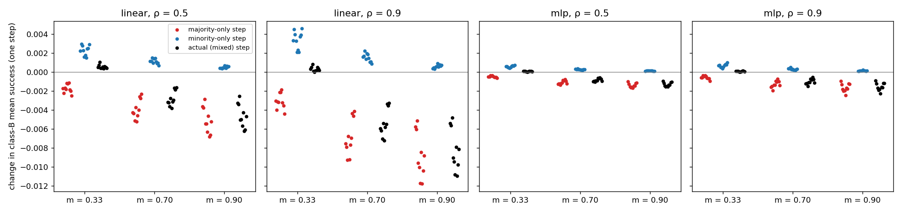

# Findings: v3d (pre-registered in PREREG_v3d.md, exploratory)

Generated by `experiments/analyze_v3d.py` from 1760 runs. Class A is answer class 0 (share m); class B is the rest (the minority when m > 1/3).

## T11: one-step branches from a common state (SGD, η = 0.01, exact expected update)

Mixed-branch check: largest |mixed − expected_step| = 5.9e-17 over all 1920 branch points.

Δ_B(X): change in the mean success of class B (the minority when m > 1/3) after one step along X. Counts are tasks out of 10; ✗ marks a cell below 9 of 10.

### Predictions 1 and 2: steps 0 and 0.1T

| arch | rho | m | at | p_B | Δ_B(A) < 0 | Δ_B(B) > 0 | Δ_B(mixed) < 0 | cos(g_A, ∇p_B) < 0 | med_dB_A | med_dB_B | med_dB_mixed | med_ratio |
|---|---|---|---|---|---|---|---|---|---|---|---|---|
| linear | 0.5 | 0.333 | 0T | 0.333 | 10/10 | 10/10 | 0/10 ✗ | 10/10 | -0.00179 | 0.00234 | 0.000484 | 0.776 |
| linear | 0.5 | 0.333 | 0.1T | 0.631 | 10/10 | 10/10 | 0/10 ✗ | 10/10 | -0.00163 | 0.00176 | 0.000149 | 0.923 |
| linear | 0.5 | 0.7 | 0T | 0.333 | 10/10 | 10/10 | 10/10 | 10/10 | -0.00417 | 0.00109 | -0.00305 | 3.61 |
| linear | 0.5 | 0.7 | 0.1T | 0.0155 | 10/10 | 10/10 | 10/10 | 10/10 | -2.05e-05 | 1.37e-05 | -7.86e-06 | 1.81 |
| linear | 0.5 | 0.9 | 0T | 0.333 | 10/10 | 10/10 | 10/10 | 10/10 | -0.00536 | 0.000416 | -0.00487 | 10.7 |
| linear | 0.5 | 0.9 | 0.1T | 0.00559 | 10/10 | 10/10 | 10/10 | 10/10 | -5.87e-06 | 7.79e-07 | -4.92e-06 | 7.55 |
| linear | 0.9 | 0.333 | 0T | 0.333 | 10/10 | 10/10 | 1/10 ✗ | 10/10 | -0.00317 | 0.00351 | 0.000229 | 0.922 |
| linear | 0.9 | 0.333 | 0.1T | 0.433 | 10/10 | 10/10 | 0/10 ✗ | 10/10 | -0.00294 | 0.00295 | 7.23e-05 | 0.991 |
| linear | 0.9 | 0.7 | 0T | 0.333 | 10/10 | 10/10 | 10/10 | 10/10 | -0.00727 | 0.0015 | -0.00568 | 4.74 |
| linear | 0.9 | 0.7 | 0.1T | 0.00205 | 10/10 | 10/10 | 10/10 | 10/10 | -2.76e-06 | 7.24e-07 | -2.1e-06 | 4.52 |
| linear | 0.9 | 0.9 | 0T | 0.333 | 10/10 | 10/10 | 10/10 | 10/10 | -0.00923 | 0.000553 | -0.0086 | 16.3 |
| linear | 0.9 | 0.9 | 0.1T | 0.00132 | 10/10 | 10/10 | 10/10 | 10/10 | -1.41e-06 | 9.37e-08 | -1.32e-06 | 17 |
| mlp | 0.5 | 0.333 | 0T | 0.333 | 10/10 | 10/10 | 1/10 ✗ | 10/10 | -0.000522 | 0.000584 | 5.16e-05 | 0.915 |
| mlp | 0.5 | 0.333 | 0.1T | 0.455 | 10/10 | 10/10 | 0/10 ✗ | 10/10 | -0.00158 | 0.00199 | 0.000303 | 0.873 |
| mlp | 0.5 | 0.7 | 0T | 0.333 | 10/10 | 10/10 | 10/10 | 10/10 | -0.00117 | 0.000247 | -0.000926 | 4.59 |
| mlp | 0.5 | 0.7 | 0.1T | 0.00185 | 10/10 | 10/10 | 10/10 | 10/10 | -3.62e-06 | 1.21e-06 | -2.18e-06 | 3.25 |
| mlp | 0.5 | 0.9 | 0T | 0.333 | 10/10 | 10/10 | 10/10 | 10/10 | -0.00148 | 9.64e-05 | -0.00138 | 15.8 |
| mlp | 0.5 | 0.9 | 0.1T | 0.000571 | 10/10 | 10/10 | 10/10 | 10/10 | -8.26e-07 | 4.99e-08 | -7.76e-07 | 16.6 |
| mlp | 0.9 | 0.333 | 0T | 0.333 | 10/10 | 10/10 | 1/10 ✗ | 10/10 | -0.000616 | 0.000672 | 5.33e-05 | 0.926 |
| mlp | 0.9 | 0.333 | 0.1T | 0.381 | 10/10 | 10/10 | 1/10 ✗ | 10/10 | -0.000776 | 0.000815 | 4.83e-05 | 0.952 |
| mlp | 0.9 | 0.7 | 0T | 0.333 | 10/10 | 10/10 | 10/10 | 10/10 | -0.00138 | 0.000278 | -0.0011 | 4.77 |
| mlp | 0.9 | 0.7 | 0.1T | 0.000507 | 10/10 | 10/10 | 10/10 | 10/10 | -9.1e-07 | 1.99e-07 | -6.91e-07 | 4.89 |
| mlp | 0.9 | 0.9 | 0T | 0.333 | 10/10 | 10/10 | 10/10 | 10/10 | -0.00174 | 0.000103 | -0.00163 | 17.1 |
| mlp | 0.9 | 0.9 | 0.1T | 0.000254 | 10/10 | 10/10 | 10/10 | 10/10 | -3.84e-07 | 1.84e-08 | -3.63e-07 | 18.8 |

- **Prediction 1 (active reversal before collapse):** holds in 16 of 16 imbalanced cells over both early points (8 of 8 at step 0).
- **Prediction 2 (balanced control, Δ_B(mixed) > 0 at step 0):** holds in 4 of 4 cells.

- **Prediction 3 (starvation after collapse):** at 0.5T and 0.9T, 125 branch points have minority mean below 1e-3; |Δ_B(B)| is below 1% of its step-0 value in 125 of them (median ratio 6.9e-06).

### Prediction 4: the majority's push relative to the minority's own gain, −Δ_B(A)/Δ_B(B), at step 0

Above 1 means the mixed step lowers the minority.

| arch | rho | ratio_m07 | ratio_m09 | tasks_larger | p |
|---|---|---|---|---|---|
| linear | 0.5 | 3.61 | 10.7 | 10/10 | 0.000977 |
| linear | 0.9 | 4.74 | 16.3 | 10/10 | 0.000977 |
| mlp | 0.5 | 4.59 | 15.8 | 10/10 | 0.000977 |
| mlp | 0.9 | 4.77 | 17.1 | 10/10 | 0.000977 |

- **Prediction 5 (sampled GRPO, 16 batches per point, step 0):** the mean sampled Δ_B has the sign of the exact one in 100% (A-only), 100% (B-only) and 89% (mixed) of 120 runs.

### Adam (descriptive; actual displacements, imbalanced tasks)

| eta | frac | Δ_B(A) < 0 | Δ_B(B) > 0 | Δ_B(mixed) < 0 | runs |
|---|---|---|---|---|---|
| 0.0001 | 0 | 100% | 100% | 100% | 80 |
| 0.0001 | 0.1 | 100% | 1% | 99% | 80 |
| 0.001 | 0 | 100% | 100% | 100% | 80 |
| 0.001 | 0.1 | 96% | 21% | 84% | 80 |

## T12: plateau or permanent (10× the T1 horizon)

`ever_below`: runs whose minority class mean fell below 1e-3; `recovered`: of those, runs ending above 0.01. `minority_absorbed`: share of minority prompts below 1e-3 over the last 20% of steps.

- **Prediction 1 (no recovery, SGD):** 409 of 480 SGD runs fell below 1e-3; 34 of them recovered (8.3%; predicted ≤ 5%).

| arch | rho | m | eta | runs | ever_below | recovered | b_min | b_final | minority_absorbed |
|---|---|---|---|---|---|---|---|---|---|
| linear | 0.5 | 0.7 | 0.01 | 20 | 4 | 0 | 0.011 | 0.881 | 0 |
| linear | 0.5 | 0.7 | 0.1 | 20 | 4 | 0 | 0.0112 | 0.881 | 0 |
| linear | 0.5 | 0.7 | 1 | 20 | 4 | 0 | 0.0115 | 0.958 | 0 |
| linear | 0.5 | 0.9 | 0.01 | 20 | 16 | 0 | 0.000279 | 0.00035 | 0.943 |
| linear | 0.5 | 0.9 | 0.1 | 20 | 16 | 1 | 0.000335 | 0.000353 | 0.942 |
| linear | 0.5 | 0.9 | 1 | 20 | 15 | 6 | 8.52e-05 | 0.0596 | 0.889 |
| linear | 0.9 | 0.7 | 0.01 | 20 | 20 | 0 | 2.31e-05 | 2.31e-05 | 1 |
| linear | 0.9 | 0.7 | 0.1 | 20 | 20 | 0 | 2.26e-05 | 2.26e-05 | 1 |
| linear | 0.9 | 0.7 | 1 | 20 | 20 | 0 | 2.25e-06 | 2.38e-06 | 1 |
| linear | 0.9 | 0.9 | 0.01 | 20 | 20 | 0 | 1.36e-05 | 1.36e-05 | 1 |
| linear | 0.9 | 0.9 | 0.1 | 20 | 20 | 0 | 1.37e-05 | 1.37e-05 | 1 |
| linear | 0.9 | 0.9 | 1 | 20 | 20 | 0 | 1.4e-06 | 1.4e-06 | 1 |
| mlp | 0.5 | 0.7 | 0.01 | 20 | 16 | 4 | 4.66e-05 | 6.14e-05 | 0.983 |
| mlp | 0.5 | 0.7 | 0.1 | 20 | 16 | 5 | 5.79e-05 | 0.000155 | 0.983 |
| mlp | 0.5 | 0.7 | 1 | 20 | 18 | 11 | 3.09e-05 | 0.593 | 0.0398 |
| mlp | 0.5 | 0.9 | 0.01 | 20 | 20 | 2 | 2.99e-06 | 2.99e-06 | 1 |
| mlp | 0.5 | 0.9 | 0.1 | 20 | 20 | 2 | 2.44e-06 | 2.44e-06 | 1 |
| mlp | 0.5 | 0.9 | 1 | 20 | 20 | 3 | 1.48e-07 | 1.48e-07 | 1 |
| mlp | 0.9 | 0.7 | 0.01 | 20 | 20 | 0 | 1.74e-06 | 1.74e-06 | 1 |
| mlp | 0.9 | 0.7 | 0.1 | 20 | 20 | 0 | 1.68e-06 | 1.68e-06 | 1 |
| mlp | 0.9 | 0.7 | 1 | 20 | 20 | 0 | 8.66e-08 | 8.66e-08 | 1 |
| mlp | 0.9 | 0.9 | 0.01 | 20 | 20 | 0 | 9.39e-07 | 9.39e-07 | 1 |
| mlp | 0.9 | 0.9 | 0.1 | 20 | 20 | 0 | 9.06e-07 | 9.06e-07 | 1 |
| mlp | 0.9 | 0.9 | 1 | 20 | 20 | 0 | 5.57e-08 | 5.57e-08 | 1 |

### Prediction 2: linear policy, Adam at η = 1e-4, 50,000 steps, ρ = 0.9

| m | update | tasks with minority absorption > 0.5 | median minority absorption | median b_final |
|---|---|---|---|---|
| 0.7 | expected_full | 7/10 | 1 | 4.6e-10 |
| 0.7 | sampled | 10/10 | 1 | 5.42e-06 |
| 0.9 | expected_full | 10/10 | 1 | 1.13e-10 |
| 0.9 | sampled | 10/10 | 1 | 2.43e-06 |

### Prediction 3: minority mean when the majority has gained +0.10 (m = 0.9)

| arch | rho | optimizer | update | reached +0.10 | minority below start there | median minority mean there |
|---|---|---|---|---|---|---|
| linear | 0.5 | adam | expected_full | 10/10 | 10/10 | 0.265 |
| linear | 0.5 | adam | sampled | 10/10 | 10/10 | 0.273 |
| linear | 0.5 | sgd | expected_full | 10/10 | 10/10 | 0.0108 |
| linear | 0.5 | sgd | sampled | 10/10 | 10/10 | 0.0107 |
| linear | 0.9 | adam | expected_full | 10/10 | 10/10 | 0.254 |
| linear | 0.9 | adam | sampled | 10/10 | 10/10 | 0.256 |
| linear | 0.9 | sgd | expected_full | 10/10 | 10/10 | 0.00266 |
| linear | 0.9 | sgd | sampled | 10/10 | 10/10 | 0.00255 |
| mlp | 0.5 | adam | expected_full | 10/10 | 10/10 | 0.0158 |
| mlp | 0.5 | adam | sampled | 10/10 | 10/10 | 0.022 |
| mlp | 0.5 | sgd | expected_full | 10/10 | 10/10 | 0.00164 |
| mlp | 0.5 | sgd | sampled | 10/10 | 10/10 | 0.0016 |
| mlp | 0.9 | adam | expected_full | 10/10 | 10/10 | 0.0119 |
| mlp | 0.9 | adam | sampled | 10/10 | 10/10 | 0.0167 |
| mlp | 0.9 | sgd | expected_full | 10/10 | 10/10 | 0.00073 |
| mlp | 0.9 | sgd | sampled | 10/10 | 10/10 | 0.00066 |

### Adam cells (descriptive)

| arch | rho | m | eta | runs | ever_below | recovered | b_final | minority_absorbed |
|---|---|---|---|---|---|---|---|---|
| linear | 0.5 | 0.7 | 0.0001 | 20 | 4 | 1 | 0.742 | 0 |
| linear | 0.5 | 0.7 | 0.001 | 20 | 4 | 2 | 0.946 | 0 |
| linear | 0.5 | 0.9 | 0.0001 | 20 | 11 | 2 | 0.0369 | 0.91 |
| linear | 0.5 | 0.9 | 0.001 | 20 | 10 | 3 | 0.259 | 0.735 |
| linear | 0.9 | 0.7 | 0.0001 | 20 | 20 | 4 | 4.69e-06 | 1 |
| linear | 0.9 | 0.7 | 0.001 | 20 | 20 | 5 | 1.48e-07 | 1 |
| linear | 0.9 | 0.9 | 0.0001 | 20 | 20 | 1 | 6.2e-07 | 1 |
| linear | 0.9 | 0.9 | 0.001 | 20 | 20 | 2 | 3.29e-08 | 1 |
| mlp | 0.5 | 0.7 | 0.0001 | 20 | 10 | 7 | 0.987 | 0.0124 |
| mlp | 0.5 | 0.7 | 0.001 | 20 | 12 | 9 | 0.993 | 0.00687 |
| mlp | 0.5 | 0.9 | 0.0001 | 20 | 19 | 9 | 0.04 | 0.96 |
| mlp | 0.5 | 0.9 | 0.001 | 20 | 20 | 7 | 8.85e-10 | 1 |
| mlp | 0.9 | 0.7 | 0.0001 | 20 | 20 | 5 | 2.86e-08 | 1 |
| mlp | 0.9 | 0.7 | 0.001 | 20 | 20 | 4 | 1.47e-13 | 1 |
| mlp | 0.9 | 0.9 | 0.0001 | 20 | 20 | 1 | 1.21e-09 | 1 |
| mlp | 0.9 | 0.9 | 0.001 | 20 | 20 | 2 | 1.02e-12 | 1 |

## T13: projection control (SGD, exact expected update)

Mean share of minority prompts absorbed, over 10 tasks. `projected`: the majority part without its component against the minority's success gradient; `shortened`: the majority part scaled to the same norm.

| arch | rho | m | eta | full | shortened | projected | p_proj_lt_short | a_final_full | a_final_proj | b_final_proj |
|---|---|---|---|---|---|---|---|---|---|---|
| linear | 0.5 | 0.7 | 0.01 | 0.338 | 0 | 0 | 1 | 0.975 | 0.752 | 0.975 |
| linear | 0.5 | 0.7 | 0.1 | 0.339 | 0 | 0 | 1 | 0.975 | 0.752 | 0.975 |
| linear | 0.5 | 0.9 | 0.01 | 0.814 | 0.714 | 0 | 0.000977 | 0.999 | 0.856 | 0.98 |
| linear | 0.5 | 0.9 | 0.1 | 0.814 | 0.716 | 0 | 0.000977 | 0.999 | 0.856 | 0.98 |
| linear | 0.9 | 0.7 | 0.01 | 0.956 | 0 | 0 | 1 | 1 | 0.454 | 0.955 |
| linear | 0.9 | 0.7 | 0.1 | 0.956 | 0 | 0 | 1 | 1 | 0.459 | 0.954 |
| linear | 0.9 | 0.9 | 0.01 | 0.991 | 0.466 | 0 | 0.000977 | 1 | 0.743 | 0.971 |
| linear | 0.9 | 0.9 | 0.1 | 0.991 | 0.466 | 0 | 0.000977 | 1 | 0.743 | 0.971 |
| mlp | 0.5 | 0.7 | 0.01 | 0.861 | 0.00132 | 0.000662 | 0.5 | 1 | 0.991 | 0.999 |
| mlp | 0.5 | 0.7 | 0.1 | 0.863 | 0.00132 | 0 | 0.5 | 1 | 0.996 | 1 |
| mlp | 0.5 | 0.9 | 0.01 | 0.979 | 0.891 | 0.00408 | 0.000977 | 1 | 0.994 | 0.996 |
| mlp | 0.5 | 0.9 | 0.1 | 0.979 | 0.894 | 0.00408 | 0.000977 | 1 | 0.994 | 0.996 |
| mlp | 0.9 | 0.7 | 0.01 | 1 | 0 | 0.000662 | 1 | 1 | 0.976 | 0.999 |
| mlp | 0.9 | 0.7 | 0.1 | 1 | 0 | 0 | 1 | 1 | 0.972 | 0.906 |
| mlp | 0.9 | 0.9 | 0.01 | 1 | 0.537 | 0 | 0.00195 | 1 | 0.98 | 1 |
| mlp | 0.9 | 0.9 | 0.1 | 1 | 0.537 | 0.00816 | 0.00195 | 1 | 0.987 | 0.988 |

- **Prediction 1 (projected below shortened, p < 0.05):** 8 of 16 cells.
- **Prediction 2 (shortened within 0.05 of the unmodified update):** 0 of 16 cells.
- **Prediction 3 (majority final mean within 0.05 under projection):** 8 of 16 cells.

