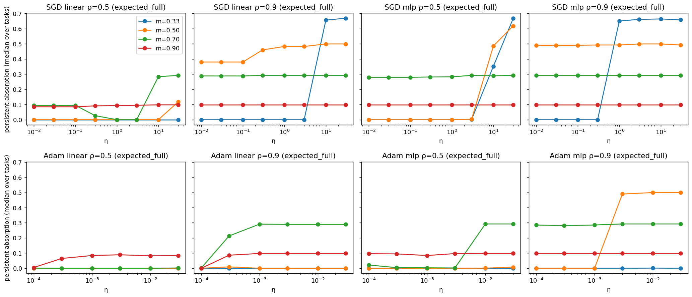
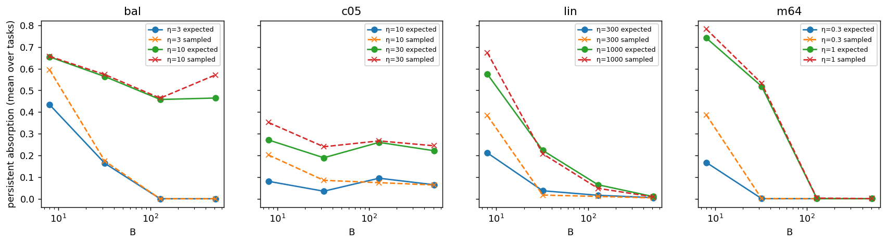

# Findings: v3 batch 1 (pre-registered in PREREG_v3a.md)

Generated by `extra/experiments/analyze_v3.py`; every number below is recomputed from the raw results.

## Verdicts at a glance

| Test | Verdict |
|---|---|
| V3_T1 | PASS (SGD cells 8/8 pass, Adam cells 8/8 pass; pre-registered rule) |
| V3_T2 | FAIL ((a) 3/4 levels with Spearman < 0 at p < 0.05 (need 3); (b) 1/4 levels inside ±0.05) |
| V3_T4 Prediction | PASS (tabular GRPO constant best G (prediction: does not increase); mean rule flatter than GRPO in 17% of (level, p₀)) |
| V3_T6 | FAIL (mismatch: multi4, ppo4) |
| V3_T8 | PASS (η ≤ 3: 60/60 runs end in the predicted basin) |

## Primary hypotheses so far

Holm–Bonferroni runs across P1–P5 once all five are in. P3–P5 are not run yet, so the table gives each raw p and the most conservative bound, p × 5 (Holm's adjusted p can only be smaller).

| Hypothesis | Pre-registered rule | Raw p (to Holm) | Bound p × 5 |
|---|---|---|---|
| P1 | PASS | 2.96e-08 | 1.48e-07 |
| P2 | FAIL | 0.00266 | 0.0133 |

## P1 (T1): absorption rises with majority share at fixed geometry

No-overshoot η set per cell: the η at which the balanced arm (m = 1/3) has median persistent absorption ≤ 0.02 over the 10 task seeds. Absorption is the persistent fraction at τ = 1e-3. Means are over (task, η) in that set.

| arch | rho | optimizer | update | n_eta | etas | abs_bal | abs_m07 | abs_m09 | wilcoxon_p | spearman | spearman_p | passed |
|---|---|---|---|---|---|---|---|---|---|---|---|---|
| linear | 0.5 | adam | expected_full | 6 | 0.0001,0.0003,0.001,0.003,0.01,0.03 | 3.26e-05 | 0.0521 | 0.0544 | 1.18e-10 | 0.687 | 3.63e-35 | True |
| linear | 0.5 | adam | sampled | 6 | 0.0001,0.0003,0.001,0.003,0.01,0.03 | 0 | 0.0607 | 0.0543 | 3.72e-10 | 0.672 | 3.92e-33 | True |
| linear | 0.5 | sgd | expected_full | 8 | 0.01,0.03,0.1,0.3,1,3,10,30 | 0.00444 | 0.13 | 0.0885 | 1.52e-13 | 0.673 | 6.25e-44 | True |
| linear | 0.5 | sgd | sampled | 8 | 0.01,0.03,0.1,0.3,1,3,10,30 | 0.0331 | 0.123 | 0.0885 | 2.96e-08 | 0.575 | 8.26e-30 | True |
| linear | 0.9 | adam | expected_full | 6 | 0.0001,0.0003,0.001,0.003,0.01,0.03 | 0 | 0.207 | 0.0811 | 7.18e-11 | 0.528 | 6.11e-19 | True |
| linear | 0.9 | adam | sampled | 6 | 0.0001,0.0003,0.001,0.003,0.01,0.03 | 0 | 0.212 | 0.0807 | 1.54e-10 | 0.517 | 4.28e-18 | True |
| linear | 0.9 | sgd | expected_full | 6 | 0.01,0.03,0.1,0.3,1,3 | 0 | 0.287 | 0.102 | 6.22e-12 | 0.328 | 1e-07 | True |
| linear | 0.9 | sgd | sampled | 5 | 0.01,0.03,0.1,0.3,1 | 0 | 0.286 | 0.102 | 3.06e-10 | 0.314 | 3.07e-06 | True |
| mlp | 0.5 | adam | expected_full | 6 | 0.0001,0.0003,0.001,0.003,0.01,0.03 | 0.00703 | 0.147 | 0.0855 | 1.43e-10 | 0.691 | 9.41e-36 | True |
| mlp | 0.5 | adam | sampled | 5 | 0.0001,0.0003,0.001,0.003,0.01 | 0.000508 | 0.172 | 0.0951 | 6.81e-10 | 0.687 | 1.33e-29 | True |
| mlp | 0.5 | sgd | expected_full | 6 | 0.01,0.03,0.1,0.3,1,3 | 0.0222 | 0.243 | 0.0983 | 2.13e-09 | 0.666 | 2e-32 | True |
| mlp | 0.5 | sgd | sampled | 5 | 0.01,0.03,0.1,0.3,1 | 0.000273 | 0.229 | 0.101 | 3.37e-10 | 0.714 | 8.31e-33 | True |
| mlp | 0.9 | adam | expected_full | 6 | 0.0001,0.0003,0.001,0.003,0.01,0.03 | 0.000553 | 0.256 | 0.103 | 6.63e-12 | 0.406 | 2.99e-11 | True |
| mlp | 0.9 | adam | sampled | 5 | 0.0001,0.0003,0.001,0.003,0.01 | 0 | 0.294 | 0.103 | 2.87e-10 | 0.36 | 8.02e-08 | True |
| mlp | 0.9 | sgd | expected_full | 4 | 0.01,0.03,0.1,0.3 | 0 | 0.294 | 0.103 | 1.43e-08 | 0.195 | 0.00666 | True |
| mlp | 0.9 | sgd | sampled | 4 | 0.01,0.03,0.1,0.3 | 0 | 0.294 | 0.103 | 1.43e-08 | 0.195 | 0.00666 | True |

P-value passed to Holm (largest Wilcoxon p over included cells): 2.96e-08.

**Verdict: PASS** (SGD cells 8/8 pass, Adam cells 8/8 pass; pre-registered rule)

### Descriptive: absorption by majority share and η

### Descriptive: who is absorbed

Pooled over all runs with any persistent absorption (all η, both optimizers and updates). `minority_share` is the share of prompts whose answer is a minority class.

| m | runs | absorbed | minority | minority_share | absorbed_minority_frac |
|---|---|---|---|---|---|
| 0.333 | 230 | 60346 | 39113 | 0.678 | 0.648 |
| 0.5 | 572 | 119125 | 116541 | 0.498 | 0.978 |
| 0.7 | 946 | 122264 | 122261 | 0.294 | 1 |
| 0.9 | 1083 | 52480 | 52480 | 0.102 | 1 |

Median over runs with absorption of (absorbed fraction ÷ minority share); 1 means the whole minority set is absorbed.

| m | optimizer | mean_ratio |
|---|---|---|
| 0.5 | adam | 1 |
| 0.5 | sgd | 1 |
| 0.7 | adam | 1 |
| 0.7 | sgd | 1 |
| 0.9 | adam | 1 |
| 0.9 | sgd | 1 |

### Descriptive: supervised control (cross-entropy, η = 1, 2,000 steps)

| arch | rho | m | persist | final_mean |
|---|---|---|---|---|
| linear | 0.5 | 0.333 | 0 | 0.946 |
| linear | 0.5 | 0.5 | 0 | 0.945 |
| linear | 0.5 | 0.7 | 0 | 0.955 |
| linear | 0.5 | 0.9 | 0 | 0.975 |
| linear | 0.9 | 0.333 | 0 | 0.898 |
| linear | 0.9 | 0.5 | 0 | 0.9 |
| linear | 0.9 | 0.7 | 0 | 0.919 |
| linear | 0.9 | 0.9 | 0 | 0.958 |
| mlp | 0.5 | 0.333 | 0 | 1 |
| mlp | 0.5 | 0.5 | 0 | 1 |
| mlp | 0.5 | 0.7 | 0 | 1 |
| mlp | 0.5 | 0.9 | 0 | 1 |
| mlp | 0.9 | 0.333 | 0 | 0.334 |
| mlp | 0.9 | 0.5 | 0 | 0.384 |
| mlp | 0.9 | 0.7 | 0 | 0.547 |
| mlp | 0.9 | 0.9 | 0 | 0.933 |

### Descriptive: per-class margins (top score minus second, over the 10 tasks)

| rho | m | class | margin_q10 | margin_q50 | margin_q90 |
|---|---|---|---|---|---|
| 0.5 | 0.333 | class 0 | 0.33 | 1.83 | 5.24 |
| 0.5 | 0.333 | minority | 0.313 | 1.72 | 4.84 |
| 0.5 | 0.5 | class 0 | 0.431 | 2.18 | 6.05 |
| 0.5 | 0.5 | minority | 0.235 | 1.58 | 4.5 |
| 0.5 | 0.7 | class 0 | 0.677 | 2.97 | 7.29 |
| 0.5 | 0.7 | minority | 0.223 | 1.43 | 4.15 |
| 0.5 | 0.9 | class 0 | 1.38 | 4.73 | 9.77 |
| 0.5 | 0.9 | minority | 0.174 | 1.15 | 3.43 |
| 0.9 | 0.333 | class 0 | 0.148 | 0.819 | 2.34 |
| 0.9 | 0.333 | minority | 0.14 | 0.769 | 2.17 |
| 0.9 | 0.5 | class 0 | 0.193 | 0.976 | 2.71 |
| 0.9 | 0.5 | minority | 0.105 | 0.706 | 2.01 |
| 0.9 | 0.7 | class 0 | 0.303 | 1.33 | 3.26 |
| 0.9 | 0.7 | minority | 0.0996 | 0.639 | 1.86 |
| 0.9 | 0.9 | class 0 | 0.619 | 2.11 | 4.37 |
| 0.9 | 0.9 | minority | 0.0777 | 0.515 | 1.53 |

## P2 (T2): kick size, not response noise, at equal mean drift

(a) Kick size. Mean persistent absorption (τ = 1e-3) under `expected` at each B, pooled over the two η and 10 tasks; one-sided Spearman(B, absorption) < 0.

| level | B=8 | B=32 | B=128 | B=512 | spearman | p | passed |
|---|---|---|---|---|---|---|---|
| bal | 0.544 | 0.363 | 0.229 | 0.232 | -0.309 | 0.00266 | True |
| c05 | 0.176 | 0.112 | 0.177 | 0.143 | -0.0419 | 0.356 | False |
| lin | 0.393 | 0.13 | 0.0403 | 0.00752 | -0.869 | 7.07e-26 | True |
| m64 | 0.454 | 0.26 | 0.000781 | 0.000586 | -0.716 | 4.12e-14 | True |

(b) Response noise. Mean of absorption(`sampled`) − absorption(`expected`) over tasks, η and B, with a 95% bootstrap CI over task seeds (10,000 draws); equivalence margin ±0.05.

| level | mean_diff | ci_lo | ci_hi | B=8 | B=32 | B=128 | B=512 | equivalent |
|---|---|---|---|---|---|---|---|---|
| bal | 0.0369 | -0.00532 | 0.0867 | 0.0816 | 0.00957 | 0.00313 | 0.0533 | False |
| c05 | 0.0389 | 0.0144 | 0.0641 | 0.101 | 0.0505 | -0.00684 | 0.0109 | False |
| lin | 0.0264 | 0.013 | 0.0402 | 0.136 | -0.0177 | -0.0109 | -0.00117 | True |
| m64 | 0.0346 | 0.0117 | 0.0567 | 0.131 | 0.00684 | 0.000977 | 9.77e-05 | False |

P-value passed to Holm (largest (a) p among the levels counted): 0.00266.

**Verdict: FAIL** ((a) 3/4 levels with Spearman < 0 at p < 0.05 (need 3); (b) 1/4 levels inside ±0.05)

Descriptive: `expected_full` (kick → 0) at the same η, mean over tasks.

| level | eta | persist_0.001 |
|---|---|---|
| bal | 3 | 0 |
| bal | 10 | 0.499 |
| c05 | 10 | 0.0645 |
| c05 | 30 | 0.221 |
| lin | 300 | 0.00391 |
| lin | 1e+03 | 0.00977 |
| m64 | 0.3 | 0.000781 |
| m64 | 1 | 0.000391 |

| level | eta | update | 8 | 32 | 128 | 512 |
|---|---|---|---|---|---|---|
| bal | 3 | expected | 0.434 | 0.163 | 0 | 0 |
| bal | 3 | sampled | 0.595 | 0.173 | 0 | 0 |
| bal | 10 | expected | 0.654 | 0.563 | 0.458 | 0.464 |
| bal | 10 | sampled | 0.657 | 0.572 | 0.464 | 0.571 |
| c05 | 10 | expected | 0.0805 | 0.0348 | 0.0947 | 0.0645 |
| c05 | 10 | sampled | 0.202 | 0.085 | 0.0742 | 0.0635 |
| c05 | 30 | expected | 0.271 | 0.189 | 0.26 | 0.221 |
| c05 | 30 | sampled | 0.352 | 0.24 | 0.267 | 0.244 |
| lin | 300 | expected | 0.211 | 0.0369 | 0.016 | 0.00508 |
| lin | 300 | sampled | 0.383 | 0.017 | 0.0107 | 0.00391 |
| lin | 1e+03 | expected | 0.574 | 0.223 | 0.0646 | 0.00996 |
| lin | 1e+03 | sampled | 0.673 | 0.208 | 0.048 | 0.00879 |
| m64 | 0.3 | expected | 0.167 | 0.000781 | 0.000391 | 0.000781 |
| m64 | 0.3 | sampled | 0.387 | 0.000781 | 0.000586 | 0.000781 |
| m64 | 1 | expected | 0.741 | 0.519 | 0.00117 | 0.000391 |
| m64 | 1 | sampled | 0.783 | 0.532 | 0.00293 | 0.000586 |

## T4 (exploratory): H5 rerun, best group size with a deterministic tie-break

Samples to reach mean p ≥ 0.5 (step × 256, tracked every step), median over 5 seeds at each (G, η); best η per G; best G is the smallest G within 256 samples of the minimum. CI: 1,000 seed bootstraps. `spread` = slowest ÷ fastest G (at each G's best η). `edge_eta` lists G whose best η is at the grid edge.

| level | p0 | rule | best_G | ci_lo | ci_hi | min_samples | spread | reached | edge_eta |
|---|---|---|---|---|---|---|---|---|---|
| lin | 0.01 | grpo | 4 | 2 | 8 | 2.3e+03 | 11.2 | 7/7 | 2,4 |
| lin | 0.01 | mean | 4 | 2 | 16 | 3.07e+03 | 10.8 | 7/7 | 2,4,8 |
| lin | 0.03 | grpo | 2 | 2 | 8 | 1.02e+03 | 9.75 | 7/7 | 4 |
| lin | 0.03 | mean | 2 | 2 | 4 | 768 | 17.7 | 7/7 | 2,8 |
| lin | 0.1 | grpo | 2 | 2 | 4 | 256 | 18 | 7/7 | 2 |
| lin | 0.1 | mean | 2 | 2 | 2 | 256 | 20 | 7/7 | 8 |
| lin | 0.3 | grpo | 2 | 2 | 2 | 256 | 8 | 7/7 |  |
| lin | 0.3 | mean | 2 | 2 | 2 | 256 | 11 | 7/7 |  |
| m64 | 0.01 | grpo | 2 | 2 | 8 | 768 | 64.5 | 7/7 |  |
| m64 | 0.01 | mean | 4 | 2 | 16 | 1.02e+03 | 77.8 | 7/7 |  |
| m64 | 0.03 | grpo | 2 | 2 | 4 | 256 | 65 | 7/7 |  |
| m64 | 0.03 | mean | 2 | 2 | 4 | 1.54e+03 | 53.9 | 7/7 |  |
| m64 | 0.1 | grpo | 8 | 2 | 8 | 256 | 23 | 7/7 |  |
| m64 | 0.1 | mean | 8 | 2 | 8 | 256 | 24.5 | 7/7 |  |
| m64 | 0.3 | grpo | 2 | 2 | 8 | 1.02e+03 | 3.5 | 7/7 |  |
| m64 | 0.3 | mean | 8 | 2 | 8 | 768 | 6.33 | 7/7 |  |
| tab | 0.01 | grpo | 2 | 2 | 4 | 4.1e+03 | 1.81 | 7/7 | 2,4,8,16 |
| tab | 0.01 | mean | 4 | 2 | 4 | 4.35e+03 | 1.82 | 7/7 | 2,4,8,16,32,64,128 |
| tab | 0.03 | grpo | 2 | 2 | 4 | 1.54e+03 | 3.83 | 7/7 | 2,4,8 |
| tab | 0.03 | mean | 4 | 2 | 4 | 1.54e+03 | 3.83 | 7/7 | 2,4,8,16,32,64,128 |
| tab | 0.1 | grpo | 2 | 2 | 2 | 512 | 9 | 7/7 | 2,4 |
| tab | 0.1 | mean | 2 | 2 | 2 | 512 | 9 | 7/7 | 2,4,8,16,32 |
| tab | 0.3 | grpo | 2 | 2 | 2 | 256 | 12 | 7/7 |  |
| tab | 0.3 | mean | 2 | 2 | 2 | 256 | 12 | 7/7 | 2 |

### Prediction: in tabular GRPO the best G does not increase with p₀

- tab GRPO: best G by p₀ = 2, 2, 2, 2; Spearman nan.
- lin GRPO: best G by p₀ = 4, 2, 2, 2; Spearman -0.77.
- m64 GRPO: best G by p₀ = 2, 2, 8, 2; Spearman 0.26.

Spread across G (slowest ÷ fastest), mean rule against GRPO:

| level | p0 | grpo | mean |
|---|---|---|---|
| lin | 0.01 | 11.2 | 10.8 |
| lin | 0.03 | 9.75 | 17.7 |
| lin | 0.1 | 18 | 20 |
| lin | 0.3 | 8 | 11 |
| m64 | 0.01 | 64.5 | 77.8 |
| m64 | 0.03 | 65 | 53.9 |
| m64 | 0.1 | 23 | 24.5 |
| m64 | 0.3 | 3.5 | 6.33 |
| tab | 0.01 | 1.81 | 1.82 |
| tab | 0.03 | 3.83 | 3.83 |
| tab | 0.1 | 9 | 9 |
| tab | 0.3 | 12 | 12 |

With p₀ equal for every prompt, GRPO's normalisation only rescales each group, so a tuned η largely absorbs the difference between the rules; in tabular runs the two spreads coincide.

**Verdict: PASS** (tabular GRPO constant best G (prediction: does not increase); mean rule flatter than GRPO in 17% of (level, p₀))

## T6 (exploratory): ablations of the tabular proposition

Material drop: max over prompts of (p_init − min p) > 1e-3. Absorption: persistent at τ = 1e-3.

| ablation | runs | material_share | max_drop | mean_persist | max_persist | prediction | consistent |
|---|---|---|---|---|---|---|---|
| adam | 180 | 0 | 0 | 0 | 0 | no drops | True |
| control | 240 | 0 | 0 | 0 | 0 | no drops | True |
| flip05 | 240 | 0.738 | 0.796 | 0.0153 | 0.16 | drops | True |
| flip20 | 240 | 0.896 | 0.946 | 0.0411 | 0.383 | drops | True |
| gradclip | 240 | 0 | 0 | 0 | 0 | no drops | True |
| kl01 | 240 | 0 | 0 | 0 | 0 | below p_ref | True |
| kl1 | 240 | 0.279 | 0.483 | 0.00859 | 0.129 | below p_ref | True |
| momentum | 240 | 0 | 0 | 0 | 0 | no drops | True |
| multi4 | 240 | 0 | 0 | 0 | 0 | drops | False |
| ppo4 | 240 | 0 | 0 | 0 | 0 | drops | False |
| sign | 240 | 0.679 | 0.599 | 0.0235 | 0.262 | drops | True |

Share of runs with a material drop, by η:

| ablation | η=0.001 | η=0.01 | η=0.1 | η=0.3 | η=3 | η=30 | η=300 |
|---|---|---|---|---|---|---|---|
| adam | 0 | 0 | 0 | nan | nan | nan | nan |
| control | nan | nan | nan | 0 | 0 | 0 | 0 |
| flip05 | nan | nan | nan | 0.0833 | 0.867 | 1 | 1 |
| flip20 | nan | nan | nan | 0.583 | 1 | 1 | 1 |
| gradclip | nan | nan | nan | 0 | 0 | 0 | 0 |
| kl01 | nan | nan | nan | 0 | 0 | 0 | 0 |
| kl1 | nan | nan | nan | 0 | 0 | 0.117 | 1 |
| momentum | nan | nan | nan | 0 | 0 | 0 | 0 |
| multi4 | nan | nan | nan | 0 | 0 | 0 | 0 |
| ppo4 | nan | nan | nan | 0 | 0 | 0 | 0 |
| sign | nan | nan | nan | 0.0667 | 0.667 | 0.983 | 1 |

Mean persistent absorption, by η:

| ablation | η=0.001 | η=0.01 | η=0.1 | η=0.3 | η=3 | η=30 | η=300 |
|---|---|---|---|---|---|---|---|
| adam | 0 | 0 | 0 | nan | nan | nan | nan |
| control | nan | nan | nan | 0 | 0 | 0 | 0 |
| flip05 | nan | nan | nan | 0 | 0 | 0.000521 | 0.0608 |
| flip20 | nan | nan | nan | 0 | 0 | 0.0119 | 0.152 |
| gradclip | nan | nan | nan | 0 | 0 | 0 | 0 |
| kl01 | nan | nan | nan | 0 | 0 | 0 | 0 |
| kl1 | nan | nan | nan | 0 | 0 | 0 | 0.0344 |
| momentum | nan | nan | nan | 0 | 0 | 0 | 0 |
| multi4 | nan | nan | nan | 0 | 0 | 0 | 0 |
| ppo4 | nan | nan | nan | 0 | 0 | 0 | 0 |
| sign | nan | nan | nan | 0 | 0 | 0.00586 | 0.0881 |

KL conditions use the initial policy as the reference, so p_ref = p_init for every prompt and any drop of min p below p_init is a drop below p_ref; with only min p logged, a decline from above p_ref back towards it is not measurable. The KL prediction is therefore not testable as written.

**Verdict: FAIL** (mismatch: multi4, ppo4)

## T8 (exploratory): KL bistability without noise

Tabular, G = 64, `expected_full` with the analytic KL gradient. `above` = final p above the unstable root; predicted 1 for offsets > 0 and 0 for offsets < 0 (logit offsets from the root).

| p_ref | beta | eta | -3 | -2 | -1 | -0.5 | -0.25 | +0 | +0.25 | +0.5 | +1 | +2 | +3 |
|---|---|---|---|---|---|---|---|---|---|---|---|---|---|
| 0.01 | 0.5 | 1 | 0 | 0 | 0 | 0 | 0 | 0 | 1 | 1 | 1 | 1 | 1 |
| 0.01 | 0.5 | 3 | 0 | 0 | 0 | 0 | 0 | 0 | 1 | 1 | 1 | 1 | 1 |
| 0.01 | 0.5 | 10 | 0 | 0 | 0 | 0 | 0 | 0 | 1 | 1 | 1 | 1 | 1 |
| 0.03 | 0.5 | 1 | 0 | 0 | 0 | 0 | 0 | 0 | 1 | 1 | 1 | 1 | 1 |
| 0.03 | 0.5 | 3 | 0 | 0 | 0 | 0 | 0 | 0 | 1 | 1 | 1 | 1 | 1 |
| 0.03 | 0.5 | 10 | 0 | 0 | 0 | 0 | 0 | 0 | 1 | 1 | 1 | 1 | 1 |
| 0.2 | 1 | 1 | 0 | 0 | 0 | 0 | 0 | 0 | 1 | 1 | 1 | 1 | 1 |
| 0.2 | 1 | 3 | 0 | 0 | 0 | 0 | 0 | 0 | 1 | 1 | 1 | 1 | 1 |
| 0.2 | 1 | 10 | 0 | 0 | 0 | 0 | 0 | 0 | 1 | 1 | 1 | 1 | 1 |

At η = 10, 0 of 15 runs that start above the root end below it, without any noise.

**Verdict: PASS** (η ≤ 3: 60/60 runs end in the predicted basin)

